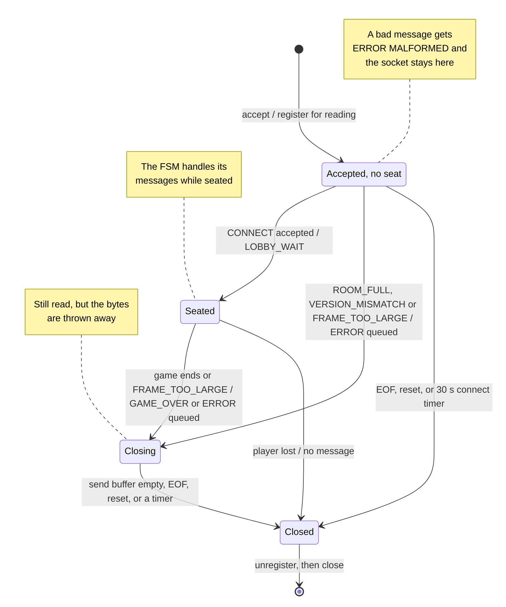

# Battleship Server Concurrency Design

**Course:** CS 457
**Written by:** Landon Holland

---

## 1. Concurrency Model

The server uses **Option B: non-blocking I/O multiplexing**. It runs one thread with one `selectors.DefaultSelector`, and every socket is set to non-blocking with `sock.setblocking(False)`. All messages, error codes, and states named here are defined in [`protocol_blueprint.md`](protocol_blueprint.md) and [`fsm_specification.md`](fsm_specification.md).

### How it works

- The selector watches the listening socket and every client socket at the same time.
- Each pass of the event loop asks the selector which sockets are ready to read or write, then calls the handler for each ready socket one at a time.
- A handler does its work and returns. It never waits on a socket, so the loop is always free to service the other player.
- Each connection keeps its own receive buffer and send buffer on the selector key's `data` (blueprint #6, The Receiver Algorithm). A message that arrives in pieces waits in its receive buffer, and a message that cannot be sent in full waits in its send buffer.
- The selector is called with a timeout, so the loop wakes up to check the 500 s placement and turn timers even when no socket has data (blueprint #5, Timeouts).

### Why Option B

| Reason                                               | What it means for this game                                                                                                                                                                                               |
| ---------------------------------------------------- | ------------------------------------------------------------------------------------------------------------------------------------------------------------------------------------------------------------------------- |
| **The workload is small**                      | Two players, one shot at a time, and the largest message (`STATE_UPDATE`) is about 550 bytes. There is no heavy work to spread across threads, so threads would add risk without adding speed                           |
| **Only one thing ever changes the game state** | One thread runs every handler, each handler finishes before the next one starts. Two handlers can never change the boards or `active_player` at the same time, so race conditions are ruled out by design, not by locks |
| **Frames never mix on the wire**               | Every outgoing message is added whole to the end of that connection's send buffer, and only the event loop writes from it. Two messages for the same player can never be cut into each other                              |
| **Timers fit in the same loop**                | The 500 s timers are checked by the same thread on every pass. No timer thread and no `settimeout` is needed                                                                                                            |
| **It matches the spec already written**        | The receiver algorithm (blueprint #6), the termination handlers (blueprint #7), and the buffer caps (blueprint #5) were all written for a single-threaded `selectors` loop                                              |

### Why I did not go with Option A (a thread per client)

A thread per client would work, but every benefit above would have to be rebuilt by hand:

- **Shared state needs a lock.** Both client threads read and write the same session: the boards, `active_player`, the shot counts, and the seat list. Every check-then-change (for example "is it this player's turn? then fire") would need to hold a `threading.Lock`, or both players could act on the same turn.
- **Sockets are shared too.** When a shot ends the game, the shooter's thread has to send `GAME_OVER` to the opponent's socket while the opponent's own thread may be writing an `ERROR` to it. Without a second lock per socket, two `sendall` calls can mix their bytes mid-frame and break the newline framing (blueprint #6).
- **Timers need their own thread.** A thread blocked in `recv()` cannot check a 500 s deadline, so the design would need `settimeout` or a separate timer thread, which is one more thing touching the session.
- **More locks means more ways to deadlock.** A game lock plus a lock per socket can deadlock if two threads take them in a different order.

### The trade-off

The one weakness of a single thread is that one slow handler stalls everyone. So the rule for this server is that **no handler may block**: no blocking calls, no `sendall`, no `settimeout`, no `sleep`. Section 3 covers how the server stays inside that rule and why it keeps the game state safe without any locks.

---

## 2. Connection Lifecycle

Every client socket goes through the same five stages. The listening socket goes through only the first one, and it stays open for as long as the server runs.

| Stage               | Triggered by                                            | What the server does                                                                                            | FSM state                            | Spec                      |
| ------------------- | ------------------------------------------------------- | --------------------------------------------------------------------------------------------------------------- | ------------------------------------ | ------------------------- |
| 1. Listen           | The server process starts                               | Opens port 5000 and registers the listening socket with the selector                                            | `INIT`                             | FSM #4                    |
| 2. Accept           | The listening socket is readable                        | Accepts the new socket, makes it non-blocking, gives it its own buffers, registers it                           | Any                                  | This section              |
| 3. Registration     | The client's first `CONNECT`                          | Assigns a seat (`Player_1` or `Player_2`) and replies `LOBBY_WAIT` or rejects and closes                  | `WAITING_FOR_PLAYERS`              | Blueprint #2, `CONNECT` |
| 4. Active servicing | The socket is readable or writable, or a timer runs out | Reads and handles messages, writes queued messages, checks the 500 s timers                                     | `FLEET_PLACEMENT`, `PLAYER_TURN` | Blueprint #5, #6, #7      |
| 5. Teardown         | The player is lost or the game ended                    | Stops handling its messages, closes the socket once its send buffer is empty, unregisters it before `close()` | `GAME_OVER`, `CLEANUP`           | Blueprint #5, #7          |

**One client socket's lifecycle.** From the server's side. Every client socket is in one of four states. These are socket states: the game FSM in [`fsm_specification.md`](fsm_specification.md) only ever acts on sockets that are seated. These are NOT game states. The listening socket is not shown. It is opened in `INIT` and stays listening for as long as the server runs (2.1).

**Mermaid link:** [Open this diagram in the Mermaid Live Editor](https://mermaid.live/edit#pako:eNp9VMmOm0AQ_ZUSxwgrUebmQySGAY8lcEdAEo1CZLXpAqNA49BNLDSaf081y3hV-kYt773aeLWyRqC1BEtprvGp5EXL68Xfz6kEeoMRUsvJMjxoFDbIBhRynVrAFTiu631NvKfL4Jj8KMaI2HNu_G7VqFIWY4AbsHi9Wd1GzAgmwCCMET8__ILF4ss7MyyBD9rgI7RYlEpjC3nT0gcXhmTIeo82qaMkSnTZZuO5yQSAgiAC9vj4sv3hrJM7iZNUyowYC7f-tyCw4bsXxWu22YbrOHQS9xmI24-c0NsmjG0DJ1p5hOtFEYvgT4cdlXUfeZDkMd8m6Qq1bYAePoGCrJESMw26rLGd-zAVcSmr4DUCSqHui1gZAyPBxn2r6Apy0HOoeE8NpXGYBtPsa1SKFzjLmLkvkhRJgF2X55SJ9UH39nVdfC5mxph4zXSX0Ml5kjboPUrIzDrMlLKhFakw19DkVws49BV2XMwyoUCtTr6x5tAJfBaFRMmlODmJCVST_UZt1rBXsMcWR7epx9DelXC-4eYlhOPHIewJvUIF5bmCSZeC476scLikuf3_Jbm4kmFYuqyqYcltarUe1O96jWdcvEUyt81RAj_y_prFssGiGdS8FOb8X40_tQinxpQMqSUw511Fl57KNxPMO93EvczIqdsOydIdxOmfMZnf_gE-u0xD) (Way easier to see)



| Transition                                                                                                                                 | Where it is described                                                  |
| ------------------------------------------------------------------------------------------------------------------------------------------ | ---------------------------------------------------------------------- |
| `accept` into "Accepted, no seat"                                                                                                        | 2.2                                                                    |
| "Accepted, no seat" to "Seated", or rejected                                                                                               | 2.3, blueprint #2 `CONNECT`                                          |
| Messages handled while seated                                                                                                              | 2.4, blueprint #6 The Receiver Algorithm                               |
| "Player lost": `DISCONNECT`, EOF, reset, a 500 s timeout, or a full send buffer. The socket is closed right away with nothing sent to it | 2.5, blueprint #5 rows 2 to 7 (row 6 is the `FRAME_TOO_LARGE` arrow) |
| "Closing" to "Closed": the last queued message has been sent, the client went away, or a timer ran out                                     | 2.5, 2.6, blueprint #5 Timeouts                                        |

A rejected client that never reads its `ERROR` would stay in "Closing" forever if nothing else closed it. It still has no seat, so the 30 s connect timer closes it. A seated client that never reads its `GAME_OVER` is closed by the 10 s game over timer.

### 2.1 Listen

This happens once in `INIT`:

1. Create a TCP socket: `socket.socket(socket.AF_INET, socket.SOCK_STREAM)`.
2. Set `SO_REUSEADDR`, so the server can be restarted right away without waiting for the old port 5000 to be released by the OS.
3. `bind(("", 5000))`. The empty host means every interface, so clients reach it at `192.168.20.100` (SOW 5.1) through `server.holland.edu`.
4. `listen()`, then `setblocking(False)`, so `accept()` can never stall the loop.
5. Register it with `sel.register(lsock, selectors.EVENT_READ, data=None)`. A `data` of `None` is how the event loop tells the listening socket apart from client sockets, which always carry a connection object.

The listening socket is never closed between games. `CLEANUP` only closes the two client sockets, so the next two players can connect as soon as a game ends (blueprint #5, What each machine does, step 5).

### 2.2 Accept

When the selector reports the listening socket as readable, a client has finished the TCP handshake:

1. Call `accept()` once. It returns the new socket and the client's address. If it raises `BlockingIOError` or `ConnectionAbortedError` (the client gave up or reset before the server got to it), nothing happens and the loop moves on. Any other `OSError` is skipped the same way (see 2.7, The selector is not the limit).
2. Call `setblocking(False)` on the new socket. Every socket the server uses is non-blocking.
3. Create the socket's connection object and register the socket with `selectors.EVENT_READ` and `data=conn`.

The connection object holds everything that belongs to one socket and nothing that belongs to the game:

| Field            | Starts as                      | What it is                                                                                                                                            |
| ---------------- | ------------------------------ | ----------------------------------------------------------------------------------------------------------------------------------------------------- |
| `frames`       | an empty `FrameBuffer`       | The receive buffer and the receiver algorithm (blueprint #6)                                                                                          |
| `out`          | an empty `bytearray`         | The send buffer. Whole frames are added to the end, and the loop writes from the front                                                                |
| `player_id`    | `None`                       | The ID assigned to this socket, set at registration. Every later message is checked against it (FSM #6)                                               |
| `closing`      | `False`                      | Becomes `True` once the socket is being closed or the game has ended. Anything that arrives after that is read and thrown away, never handled (2.6) |
| `connected_at` | `time.monotonic()` at accept | When the socket was accepted. If it still has no seat 30 s later, the connect timer closes it (blueprint #5, Timeouts)                                |

Accepting a socket does not give it a seat. It is accepted in every state so a 3rd client should not be left hanging in the OS backlog. It only finds out the room is full when it sends `CONNECT` (2.3).

### 2.3 Registration

A socket becomes a player when its first `CONNECT` is accepted. The server runs the `CONNECT` steps from blueprint #2 in order, and the first one that fails decides the reply:

1. The message fails a shape check (for example a `display_name` that is not 1 to 20 letters `a` to `z`), or `player_id` is not `null`: `ERROR` (`MALFORMED`). The socket stays open.
2. The socket already has a `player_id`: `ERROR` (`WRONG_PHASE`). The socket stays open.
3. The `version` is not `"0.0"`: `ERROR` (`VERSION_MISMATCH`), then the socket is closed.
4. Both seats are taken: `ERROR` (`ROOM_FULL`), then the socket is closed.
5. Otherwise the server assigns the next seat in join order, sets `conn.player_id`, stores the display name, adds the socket to the session's seat list, and replies `LOBBY_WAIT`.

When the 2nd seat is filled, the server goes through `GAME_START` in the same event-loop step: it sends `GAME_START` to both players, starts both 500 s placement timers, and moves to `FLEET_PLACEMENT` (FSM #4).

An unseated socket that sends anything other than `CONNECT` gets `ERROR` (`MALFORMED`), because only `CONNECT` may have a `null` `player_id` and the socket has no ID for any other value to match (blueprint #1, Player ID Validation).

If `Player_1` is lost while waiting in the lobby, the server closes the socket, wipes the ID, and frees the seat. The next client to connect becomes `Player_1` (blueprint #5, Not a game end).

### 2.4 Active Servicing

Once both players are seated, every pass of the event loop does three things:

1. **Wait.** `sel.select(timeout=1.0)` returns the sockets that are ready, or an empty list after 1 second if none are.
2. **Service each ready socket, one at a time.**
   - Listening socket (`data` is `None`): accept, as in 2.2.
   - Readable client socket: `on_readable`. It calls `recv(4096)` once, feeds the bytes to `conn.frames`, and handles every complete message in arrival order (blueprint #6, The Receiver Algorithm). Each message goes through the shape checks and then the FSM.
   - Writable client socket: `on_writable`. It calls `send()` once, removes only the bytes that went out from the front of `conn.out`, and stops watching for write readiness once `conn.out` is empty (blueprint #7, In Code).
3. **Check timers.** `check_timers(time.monotonic())` looks for a placement or turn timer that has reached 500 s, which means that player is lost, for a game over timer that has reached 10 s, which closes whatever is still open and runs `CLEANUP`, and for a socket without a seat whose `connected_at` is 30 s old, which is closed with no message (blueprint #5, Timeouts).

**Why write readiness is only watched sometimes.** A healthy socket can almost always take more bytes, so a socket registered for `EVENT_WRITE` all the time would be reported ready on every pass and the loop would spin at 100% CPU. So a client socket is registered for `EVENT_READ` only. Queuing a message adds `EVENT_WRITE` with `sel.modify`, and `on_writable` removes it once the send buffer is empty.

**Why a 1 second timeout.** The timeout only decides how often the loop wakes up when nothing is happening. With 1 second, a timer (500 s placement or turn, 10 s game over) fires at most 1 second late, and an idle server wakes once a second, which costs nothing.

### 2.5 Teardown

A socket is torn down in one of two ways.

**One socket on its own.** This is a rejected client (`ROOM_FULL`, `VERSION_MISMATCH`) or `Player_1` lost in the lobby. The game is not affected.

1. Set `conn.closing`. Bytes that still arrive are read and thrown away, never handled (2.6).
2. If an `ERROR` is waiting in `conn.out`, keep the socket registered until `on_writable` has sent it, so the client sees why it was closed.
3. `close_connection`: `sel.unregister(sock)` first, then `sock.close()` (blueprint #7, Closing a Socket Safely).

**The whole game.** This is every game end in the blueprint #5 table, whether the fleet was destroyed or a player was lost.

1. Queue `GAME_OVER` to each player the server can still reach, and start the 10 s game over timer.
2. Set `closing` on both connections. Keep reading, but throw the bytes away (blueprint #5, What each machine does, step 2).
3. Close each socket as soon as its send buffer is empty, so `GAME_OVER` is handed to the OS before the FIN. A socket that is already gone (EOF, reset, send buffer overflow) is closed right away and its buffers are thrown away.
4. If the 10 s timer runs out first, close any socket still open and drop its unsent bytes. This only happens to a client that has stopped reading, and it stops that client from holding the server in `GAME_OVER` forever (blueprint #5, Timeouts).
5. When both sockets are closed, run `CLEANUP`: discard the session (boards, fleets, both IDs, `active_player`, shot counts, timers).
6. Go back to `WAITING_FOR_PLAYERS`. The listening socket is still registered, so new clients can connect immediately.

In both cases a socket is unregistered before it is closed, and its connection object is dropped with it. A closed socket that stayed registered would be reported readable on every pass and spin the loop (blueprint #7, The 0 Byte EOF Rule).

### 2.6 The Event Loop in Code

This is the whole lifecycle from 2.1 to 2.5 as one loop. Standard library only. `FrameBuffer` is the receive buffer from blueprint #6. `on_readable`, `on_writable`, and `close_connection` are the handlers from blueprint #7. `check_timers` and `trigger_state_transition` belong to the FSM.

```python
import selectors
import socket
import time

sel = selectors.DefaultSelector()
PORT = 5000		# blueprint #1: TCP, port 5000
TICK = 1.0		# 2.4: an idle loop wakes once a second to check the timers

class Connection:
    """Everything that belongs to one client socket (2.2). Kept on key.data."""
    def __init__(self):
        self.frames = FrameBuffer()		# receive buffer (blueprint #6)
        self.out = bytearray()		# send buffer: whole frames, in order
        self.player_id = None		# set when CONNECT is accepted (2.3)
        self.closing = False		# set at teardown (2.5)
        self.connected_at = time.monotonic()		# for the 30 s connect timer (blueprint #5)

def open_listener():		# 2.1, FSM INIT
    lsock = socket.socket(socket.AF_INET, socket.SOCK_STREAM)
    lsock.setsockopt(socket.SOL_SOCKET, socket.SO_REUSEADDR, 1)
    lsock.bind(("", PORT))
    lsock.listen()
    lsock.setblocking(False)
    sel.register(lsock, selectors.EVENT_READ, data=None)		# None marks the listener

def on_accept(lsock):		# 2.2
    try:
        sock, addr = lsock.accept()
    except (BlockingIOError, ConnectionAbortedError):
        return		# the client left before we got to it
    except OSError:
        return		# out of file descriptors (EMFILE has no subclass of its own). Skip, try again next pass
    sock.setblocking(False)
    sel.register(sock, selectors.EVENT_READ, data=Connection())		# no seat until CONNECT

def is_open(sock):
    return sock.fileno() != -1		# a closed socket reports -1

def run():
    open_listener()		# INIT, then WAITING_FOR_PLAYERS
    while True:
        for key, mask in sel.select(timeout=TICK):		# 2.4 step 1: wait
            sock, conn = key.fileobj, key.data
            if conn is None:
                on_accept(sock)		# 2.2
                continue
            if mask & selectors.EVENT_READ and is_open(sock):
                on_readable(sock, conn)		# blueprint #6 and #7
            if mask & selectors.EVENT_WRITE and is_open(sock):
                on_writable(sock, conn)		# blueprint #7
            if conn.closing and not conn.out and is_open(sock):
                close_connection(sock)		# 2.5: last message sent, now close
        check_timers(time.monotonic())		# 2.4 step 3, blueprint #5
```

**Why every handler call checks `is_open(sock)` first.** `select()` returns all the ready sockets at once, and the loop then handles them one by one. A handler for one socket can close a different one. For example, `Player_1`'s winning `MOVE` ends the game, and `Player_2`'s socket is closed if it is already gone. If `Player_2`'s socket was also in this pass's list, the loop would call `recv()` on a closed socket and crash. The check skips it. The same check stops `on_writable` from running on a socket that `on_readable` just closed in the same pass.

**How a closing socket gets closed.** Once `conn.closing` is set, the loop closes the socket on the first pass where its send buffer is empty. A socket with a `GAME_OVER` or `ERROR` waiting stays open until `on_writable` has sent the last byte, so the message is handed to the OS before the FIN (2.5). A socket that is already gone has nothing to send, so `trigger_state_transition` closes it right away. A `GAME_OVER` that can never be sent, because the client stopped reading, is dropped by `check_timers` when the 10 s game over timer runs out, and that socket is closed then. In the full server, closing a seated socket also tells the FSM, which runs `CLEANUP` once both seats are closed.

**A closing socket is still read, but nothing is handled.** `on_readable` is the blueprint #7 handler with one addition right after the EOF check:

```python
    if conn.closing:
        return      # 2.5: the bytes are read and thrown away, never handled
```

This is blueprint #5, "What each machine does", step 2: keep reading, but throw the bytes away. If the socket were not read at all, two things could go wrong. A client that closes first would leave its socket readable on every pass and spin the loop (blueprint #7). And closing a socket that still has unread bytes makes the OS send a TCP RST instead of a FIN, which can make the client lose the `GAME_OVER` it has not read yet.

**What the loop never does.** It never waits on one socket. Every call in it either returns right away (`accept`, `recv`, and `send` on non-blocking sockets) or is the one place the loop is allowed to wait: `sel.select()`, which wakes as soon as any socket is ready or the 1 second tick passes. So a client that connects and sends nothing, or stops reading, never holds up the other player, and the 10 s game over timer stops it from holding up the next game.

### 2.7 Multi-Client Capacity

The server runs one game at a time with exactly two seats (SOW 1.1). It still has to handle more than two sockets, because nothing stops a 3rd client from connecting while a game is running.

**Every kind of socket the server holds:**

| Socket                                                 | How many                     | How long it stays                         | What ends it                                                                                                         |
| ------------------------------------------------------ | ---------------------------- | ----------------------------------------- | -------------------------------------------------------------------------------------------------------------------- |
| Listening socket                                       | 1                            | As long as the server runs                | Never closed                                                                                                         |
| Seated players                                         | 0, 1, or 2                   | One game                                  | Every game end in blueprint #5: `GAME_OVER`, then closed. The 10 s game over timer is the upper bound on the close |
| Rejected clients (`ROOM_FULL`, `VERSION_MISMATCH`) | Any number, each one briefly | Until its `ERROR` is sent, at most 30 s | Closed as soon as its send buffer is empty (2.5), or by the 30 s connect timer if it never reads the `ERROR`       |
| Accepted but no `CONNECT` yet                        | Any number                   | At most 30 s                              | Its `CONNECT`, EOF or a reset (2.3), or the 30 s connect timer                                                     |

**Memory per connection is capped.** Each connection object holds at most 64 KB waiting in its receive buffer (`FRAME_TOO_LARGE`) and at most 64 KB waiting in its send buffer (blueprint #5, Send Buffer Limit). Two players are at most about 256 KB in the worst case. In a normal game each buffer holds at most one or two messages, about 1 KB.

**The selector is not the limit.** On the Linux CML nodes, `selectors.DefaultSelector` is `EpollSelector`, which is limited only by the process's open file limit, far more than this game will ever use. Accepting happens on every pass of the loop, so the OS backlog of connections waiting for `accept()` never builds up. If a flood of connections ever did use up the file descriptors, `accept()` would raise a plain `OSError` (EMFILE). `on_accept` skips it instead of crashing, the waiting connection stays in the OS backlog, and it is accepted on a later pass once the 30 s connect timer has closed the connections that never sent `CONNECT`. Until then the listening socket stays readable, so the loop runs without pausing, but it keeps servicing both players.

**Why at least 2 clients are served at the same time without blocking?** Every socket is non-blocking, and the loop only ever waits in `sel.select()`, which wakes as soon as either player's socket is ready (2.6). Each ready socket gets at most one `recv(4096)` and one `send()` per pass, then the loop moves to the next ready socket. So the two players take turns being serviced, and a player who sends a lot can have at most 4096 bytes handled before the other player's socket gets its turn.

**What one bad client can and cannot do to the other.** Each row is something a client might do, on purpose or by accident:

| A client that...                            | What the server does                                                                                                            | Why the other player is not held up                                                                                                                                                            |
| ------------------------------------------- | ------------------------------------------------------------------------------------------------------------------------------- | ---------------------------------------------------------------------------------------------------------------------------------------------------------------------------------------------- |
| Connects and sends nothing                  | Nothing. Its socket is never reported readable                                                                                  | No handler waits on it. Without a seat, the 30 s connect timer closes it. If it is seated and the game is waiting on it, its 500 s placement or turn timer ends the game (blueprint #5, row 5) |
| Sends half a message and stops              | The bytes wait in its own receive buffer (blueprint #6, Fragmentation)                                                          | Buffers are per connection, so the other player's messages are parsed as normal                                                                                                                |
| Sends more than 64 KB without a newline     | `ERROR` (`FRAME_TOO_LARGE`), then closed                                                                                    | Its receive buffer can never grow past the cap (blueprint #5, row 6)                                                                                                                           |
| Floods messages and never reads the replies | Each message is handled or rejected in turn, and a rejected one changes no state. Once its send buffer passes 64 KB, it is lost | Its replies only pile up in its own send buffer, which is capped (blueprint #5, row 7)                                                                                                         |
| Stops reading after the game ends           | Its `GAME_OVER` waits in its send buffer                                                                                      | The 10 s game over timer closes it, so `CLEANUP` still runs and the next game can start (blueprint #5, Timeouts)                                                                             |
| Crashes or resets                           | EOF, `ConnectionResetError`, `ConnectionAbortedError`, or `BrokenPipeError`. It is lost                                   | Noticed on the next read or write of its own socket (blueprint #7)                                                                                                                             |
| Loses its link without a FIN or RST         | Nothing arrives at all                                                                                                          | The 500 s timer catches it, the same as the first row (blueprint #7, Silent drop)                                                                                                              |
| Is a 3rd client while both seats are taken  | Accepted, then `ERROR` (`ROOM_FULL`) on its `CONNECT`, then closed                                                        | The game never sees it. It has no seat, so it can never touch the session (2.3)                                                                                                                |

---

## 3. Thread Safety and State Isolation

The server has no locks. It does not need them, because only one thread ever touches the game state, and each handler finishes before the next one starts. This section lists everything that is shared, shows the race each item would have if the server used a thread per client, and explains why none of them can happen in this design.

### 3.1 Shared Resources

"Shared" means touched by more than one handler: by both players' messages, by a timer, or by the code that ends the game. All of it lives in one session object or on the connection objects, and all of it is read and written only from the event-loop thread.

| Resource | Where it lives | Written by | Read by |
| -------- | -------------- | ---------- | ------- |
| FSM state | Session | Every transition: `CONNECT`, `PLACE_FLEET`, `MOVE`, `DISCONNECT` handlers, a player being lost, `check_timers`, `CLEANUP` | Every handler, to decide `WRONG_PHASE` (blueprint #3) |
| Seat list and each socket's `player_id` | Session and `conn.player_id` | `CONNECT` (assigns a seat), a player lost in the lobby (frees it), `CLEANUP` (wipes both) | `CONNECT` (is a seat free?), the shape checks (does `player_id` match the socket?, FSM #6), every message sent to "both players" |
| Display names, fleets, and boards | Session | `CONNECT` (name), `PLACE_FLEET` (that player's fleet and board), a valid `MOVE` (the defender's board and the shooter's tracking grid) | `GAME_START`, the "both fleets placed?" check, `MOVE` (resolve the shot), every `STATE_UPDATE` and `GAME_OVER` |
| `active_player` | Session | `FLEET_PLACEMENT` (set to `Player_1`), `CHECK_WIN` (flipped) | `MOVE` (`OUT_OF_TURN`), every `STATE_UPDATE` |
| Shot records and round scores: each player's fired-at cells, `shots_fired`, `stats` (`shots`, `hits`), `ships_remaining` | Session | A valid `MOVE` | `MOVE` (`ALREADY_FIRED`), `CHECK_WIN` (any ship cells left?), every `STATE_UPDATE` and `GAME_OVER` |
| Timers: 2 placement, 1 turn, 1 game over, and each unseated socket's `connected_at` | Session and `conn.connected_at` | Started and stopped by the handlers that start and end each wait (blueprint #5, Timeouts) | `check_timers`, once per loop pass |
| Receive and send buffers (`frames`, `out`) | `conn` | `frames`: only that socket's `on_readable`. `out`: any handler that queues a message to that player, including the opponent's (a shot queues a `STATE_UPDATE` to both) | `on_readable` (`frames`), `on_writable` (`out`) |
| The client socket list | The selector's registrations | `on_accept` (register), queuing a message and `on_writable` (add or remove `EVENT_WRITE`), `close_connection` (unregister) | `sel.select()` on every pass, and any handler that sends to a seated socket |

**What would go wrong with a thread per client, and why it cannot happen here:**

| Resource | Race it would have with threads (Option A) | Why it cannot happen here |
| -------- | ------------------------------------------ | ------------------------- |
| FSM state | `Player_2`'s thread notices its own socket closed and starts a forfeit while `Player_1`'s thread is applying the shot that sinks the last ship. Both threads see "game in progress" and both end the game: one sends `GAME_OVER` (`FLEET_DESTROYED`), the other `GAME_OVER` (`OPPONENT_DISCONNECTED`) | The shot and the disconnect are two separate events, handled one after the other. Whichever comes first ends the game, and the second one finds the state already in `GAME_OVER` (FSM #3, last row) |
| Seat list and `player_id` | Two clients send `CONNECT` at the same moment. Both threads see one free seat and both are given `Player_2` | `CONNECT`s are handled one at a time, so the second always sees the seat the first one took (2.3) |
| Fleets and boards | Both players send their fleet at the same moment. Each thread stores its own fleet, then checks whether the other's is stored yet. Both checks run before either store, so both get `opponent_ready: false` and turns never begin | The second `PLACE_FLEET` is handled after the first is fully stored, so exactly one of them sees both fleets and starts the turns (FSM #4) |
| `active_player` | `Player_1`'s thread flips the turn, but before it queues its two `STATE_UPDATE`s, `Player_2`'s thread fires and queues its own. A client receives the update for the later shot first, and its screen goes backward | The flip and both `STATE_UPDATE`s happen in the same handler. `Player_2`'s next `MOVE` is not even read until that handler has returned (blueprint #2, `MOVE`) |
| Shot records and scores | A board is half updated, with some cells of a sunk ship turned from `X` to `#` but not all of them, when another thread builds a `STATE_UPDATE` or `GAME_OVER` from it. The player sees a board and a `ships_remaining` that disagree | Boards, counts, and messages are all built inside one handler. Nothing can read the board in between (blueprint #4) |
| Timers | The turn timer, running in its own thread, reaches 500 s while the active player's valid `MOVE` is being applied. The shot lands and the player is also forfeited for being too slow | `check_timers` only runs between loop passes, never in the middle of a handler. The `MOVE` stops the timer before `check_timers` next looks at it, or the timer has already fired and the game is over (blueprint #5, Timeouts) |
| Receive and send buffers | The opponent's thread queues a `STATE_UPDATE` into the same send buffer, or calls `sendall` on the same socket, while this player's thread is writing an `ERROR`. The two frames are mixed mid-frame and the newline framing breaks (section 1) | Only the event loop adds to `out` and only `on_writable` sends from it. Frames are added whole, one after another (blueprint #6) |
| Client socket list | One thread closes `Player_2`'s socket while another is sending it `GAME_OVER`. If a new client is accepted in between and the OS reuses the same socket number, the `GAME_OVER`, with both fleets revealed, goes to that stranger | Only the event-loop thread registers, unregisters, and closes sockets. The only leftover risk is a socket closed earlier in the same pass, and the `is_open` check skips it (2.6) |

Each row comes down to the same two rules. 3.2 explains them: one thread, and every handler runs to completion.
