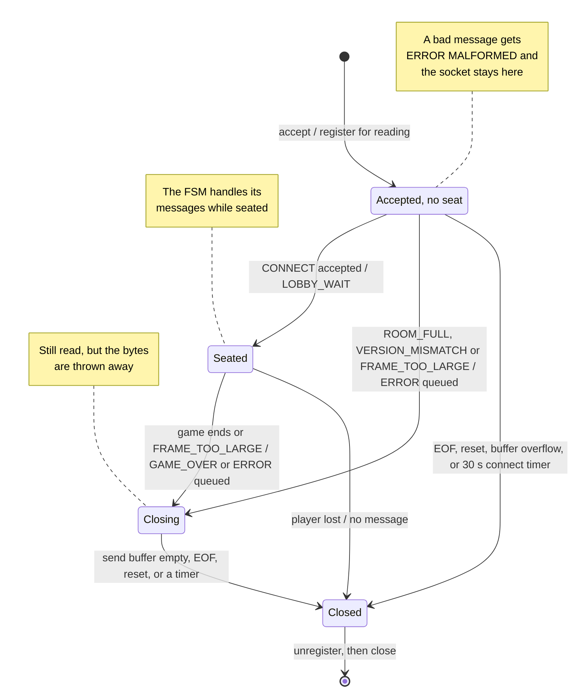
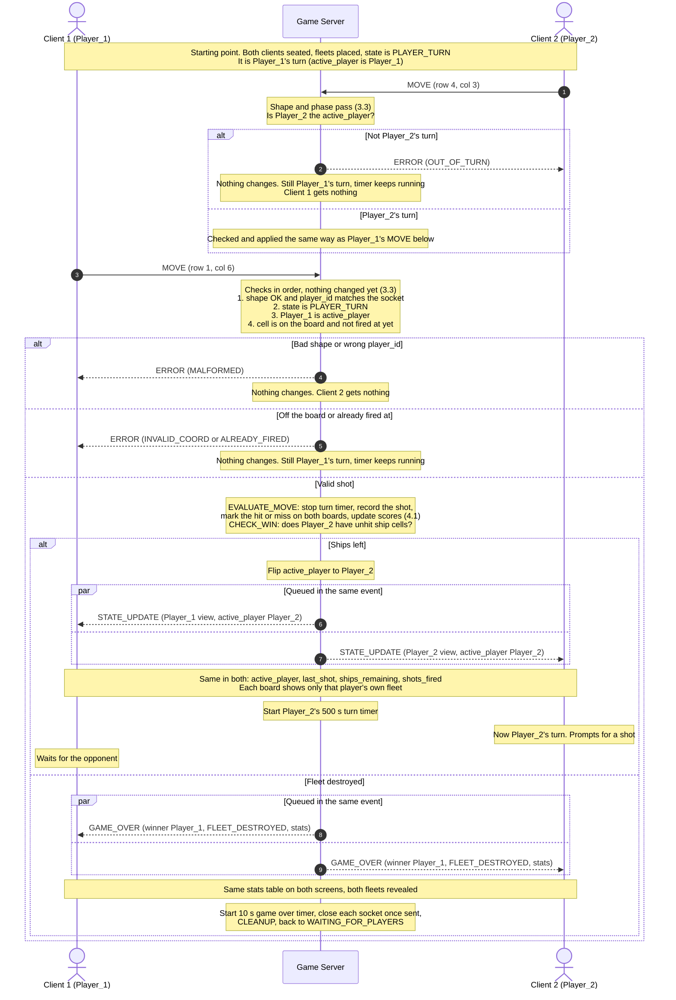

# Battleship Server Concurrency Design

**Course:** CS 457
**Written by:** Landon Holland

---

## 1. Concurrency Model

The server uses **Option B: non-blocking I/O multiplexing**. It runs one thread with one `selectors.DefaultSelector`, and every socket is set to non-blocking with `sock.setblocking(False)`. All messages, error codes, and states named here are defined in [`protocol_blueprint.md`](protocol_blueprint.md) and [`fsm_specification.md`](fsm_specification.md).

### How it works

- The selector watches the listening socket and every client socket at the same time.
- Each pass of the event loop asks the selector which sockets are ready to read or write, then calls the handler for each ready socket one at a time.
- A handler does its work and returns. It never waits on a socket, so the loop is always free to service the other player.
- Each connection keeps its own receive buffer and send buffer on the selector key's `data` (blueprint #6, The Receiver Algorithm, and #5, Send Buffer Limit). A message that arrives in pieces waits in its receive buffer, and a message that cannot be sent in full waits in its send buffer.
- The selector is called with a timeout, so the loop wakes up to check the timers (500 s placement and turn, 10 s game over, 30 s connect) even when no socket has data (blueprint #5, Timeouts).

### Why Option B

| Reason                                               | What it means for this game                                                                                                                                                                                               |
| ---------------------------------------------------- | ------------------------------------------------------------------------------------------------------------------------------------------------------------------------------------------------------------------------- |
| **The workload is small**                      | Two players, one shot at a time, and the largest message (`STATE_UPDATE`) is about 550 bytes. There is no heavy work to spread across threads, so threads would add risk without adding speed                           |
| **Only one thing ever changes the game state** | One thread runs every handler, each handler finishes before the next one starts. Two handlers can never change the boards or `active_player` at the same time, so race conditions are ruled out by design, not by locks |
| **Frames never mix on the wire**               | Every outgoing message is added whole to the end of that connection's send buffer, and only the event loop writes from it. Two messages for the same player can never be cut into each other                              |
| **Timers fit in the same loop**                | Every timer is checked by the same thread on every pass. No timer thread and no `settimeout` is needed                                                                                                            |
| **It matches the spec already written**        | The receiver algorithm (blueprint #6), the termination handlers (blueprint #7), and the buffer caps (blueprint #5) were all written for a single-threaded `selectors` loop                                              |

### Why I did not go with Option A (a thread per client)

A thread per client would work, but every benefit above would have to be rebuilt by hand:

- **Shared state needs a lock.** Both client threads read and write the same session: the boards, `active_player`, the shot counts, and the seat list. Every check-then-change (for example "is it this player's turn? then fire") would need to hold a `threading.Lock`, or both players could act on the same turn.
- **Sockets are shared too.** When a shot ends the game, the shooter's thread has to send `GAME_OVER` to the opponent's socket while the opponent's own thread may be writing an `ERROR` to it. Without a second lock per socket, two `sendall` calls can mix their bytes mid-frame and break the newline framing (blueprint #6).
- **Timers need their own thread.** A thread blocked in `recv()` cannot check a 500 s deadline, so the design would need `settimeout` or a separate timer thread, which is one more thing touching the session.
- **More locks means more ways to deadlock.** A game lock plus a lock per socket can deadlock if two threads take them in a different order.

### The trade-off

The one weakness of a single thread is that one slow handler stalls everyone. So the rule for this server is that **no handler may block**: no blocking calls, no `sendall`, no `settimeout`, no `sleep`. Section 3 covers how the server stays inside that rule and why it keeps the game state safe without any locks.

---

## 2. Connection Lifecycle

Every client socket goes through the same five stages. The listening socket goes through only the first one, and it stays open for as long as the server runs.

| Stage               | Triggered by                                            | What the server does                                                                                            | FSM state                            | Spec                      |
| ------------------- | ------------------------------------------------------- | --------------------------------------------------------------------------------------------------------------- | ------------------------------------ | ------------------------- |
| 1. Listen           | The server process starts                               | Opens port 5000 and registers the listening socket with the selector                                            | `INIT`                             | FSM #4                    |
| 2. Accept           | The listening socket is readable                        | Accepts the new socket, makes it non-blocking, gives it its own buffers, registers it                           | Any                                  | This section              |
| 3. Registration     | The client's first `CONNECT`                          | Assigns a seat (`Player_1` or `Player_2`) and replies `LOBBY_WAIT` or rejects and closes                  | `WAITING_FOR_PLAYERS` (seat), any waiting state (reject)              | Blueprint #2, `CONNECT` |
| 4. Active servicing | The socket is readable or writable, or a timer runs out | Reads and handles messages, writes queued messages, checks the timers                                     | All waiting states | Blueprint #5, #6, #7      |
| 5. Teardown         | The player is lost or the game ended                    | Stops handling its messages, closes the socket once its send buffer is empty, unregisters it before `close()` | `GAME_OVER`, `CLEANUP`           | Blueprint #5, #7          |

**One client socket's lifecycle.** From the server's side. Every client socket is in one of four states. These are socket states: the game FSM in [`fsm_specification.md`](fsm_specification.md) only ever acts on sockets that are seated. These are NOT game states. The listening socket is not shown. It is opened in `INIT` and stays listening for as long as the server runs (2.1).

**Mermaid link:** [Open this diagram in the Mermaid Live Editor](https://mermaid.live/edit#pako:eNp9VEuPmzAQ_isjjhWrVu0th0osS9JIEFdAW1WlihwYCCrYKTYbodX-944Bb56qb8zje3jGvDi5LNBZgKM01_hU86rj7cPzx0wAnTEImePlOR40Fi4ICQq5zhzgCjzfD76mwdNlcUJ5LKaKJPBu8n4jVS2qqcAPWbLerG4rLIIpMAhTxa93v-Hh4fMbMyyAj9rgPXRY1UpjB6Xs6IMXhmTseqs2rZMkavTZZhP46QyABUGE7PHx5_aHt07vNM5SqTNmLNouv4WhC9-DOFmzzTZaJ5GX-l-AuJexFwXblLFt6MWrgHCDOGYx_O2xJ1v3kUdJAVu6JF2hdmHXlyWZkc_YlY08ugb50wdQkEshMNeg6xY7ezGzq0udFW8RUBTqvqqVCTByYNK3Eq8gR4GHhg8kiuZjbpyWoUWleIVWhuW-aFIkwdrB9qAH98IokXNrxmLMvGbcC-iFHa0Leo8CcrMfllJI2pkGSw2yvNrI8aJhxwsrEyrU6pSbPEdeuGRxRJRcFKckMYGS-R_UZi8HBXvscEobP4b2roTzlTcnJZxlEsGe0BtUUJ8rmHUpOO7rBsenZa__vyQXz2Yclq6bZtx6szl6VL8bNJ5x8Q4p3MmjAH7kwzWL44JDM2h5XZj_wYvJZw7htJhRIHMKLHnf0NPPxKsp5r2WySBySuquR4r0h-L0E5nDr_8As0ZSnQ) (Way easier to see)



### 2.1 Listen

This happens once in `INIT`:

1. Create a TCP socket: `socket.socket(socket.AF_INET, socket.SOCK_STREAM)`.
2. Set `SO_REUSEADDR`, so the server can be restarted right away without waiting for the old port 5000 to be released by the OS.
3. `bind(("", 5000))`. The empty host means every interface, so clients reach it at `192.168.20.100` (SOW 5.2) through `server.holland.edu`.
4. `listen()`, then `setblocking(False)`, so `accept()` can never stall the loop.
5. Register it with `sel.register(lsock, selectors.EVENT_READ, data=None)`. A `data` of `None` is how the event loop tells the listening socket apart from client sockets, which always carry a connection object.

The listening socket is never closed between games. `CLEANUP` only closes the two client sockets, so the next two players can connect as soon as a game ends (blueprint #5, What each machine does, step 5).

### 2.2 Accept

When the selector reports the listening socket as readable, a client has finished the TCP handshake:

1. Call `accept()` once. It returns the new socket and the client's address. If it raises `BlockingIOError` or `ConnectionAbortedError` (the client gave up or reset before the server got to it), nothing happens and the loop moves on. Any other `OSError`, such as running out of file descriptors, is skipped the same way and tried again on the next pass. Until a descriptor frees up, the listening socket stays readable, so the loop runs without pausing, but it keeps servicing both players.
2. Call `setblocking(False)` on the new socket. Every socket the server uses is non-blocking.
3. Create the socket's connection object and register the socket with `selectors.EVENT_READ` and `data=conn`.

The connection object holds everything that belongs to one socket and nothing that belongs to the game:

| Field            | Starts as                      | What it is                                                                                                                                            |
| ---------------- | ------------------------------ | ----------------------------------------------------------------------------------------------------------------------------------------------------- |
| `frames`       | an empty `FrameBuffer`       | The receive buffer and the receiver algorithm (blueprint #6)                                                                                          |
| `out`          | an empty `bytearray`         | The send buffer. Whole frames are added to the end, and the loop writes from the front                                                                |
| `player_id`    | `None`                       | The ID assigned to this socket, set at registration. Every later message is checked against it (FSM #6)                                               |
| `closing`      | `False`                      | Becomes `True` once the socket is being closed or the game has ended. Anything that arrives after that is read and thrown away, never handled (2.6) |
| `connected_at` | `time.monotonic()` at accept | When the socket was accepted. If it still has no seat 30 s later, the connect timer closes it (blueprint #5, Timeouts)                                |

Accepting a socket does not give it a seat. It is accepted in every state so a 3rd client should not be left hanging in the OS backlog. It only finds out the room is full when it sends `CONNECT` (2.3).

### 2.3 Registration

A socket becomes a player when its first `CONNECT` is accepted. The server runs the `CONNECT` steps from blueprint #2 in order, and the first one that fails decides the reply:

1. The message fails a shape check (for example a `display_name` that is not 1 to 20 letters `a` to `z`), or `player_id` is not `null`: `ERROR` (`MALFORMED`). The socket stays open.
2. The socket already has a `player_id`: `ERROR` (`WRONG_PHASE`). The socket stays open.
3. The `version` is not `"0.0"`: `ERROR` (`VERSION_MISMATCH`), then the socket is closed.
4. Both seats are taken: `ERROR` (`ROOM_FULL`), then the socket is closed.
5. Otherwise the server assigns the next seat in join order, sets `conn.player_id`, stores the display name, adds the socket to the session's seat list, and replies `LOBBY_WAIT`.

When the 2nd seat is filled, the server goes through `GAME_START` in the same event-loop step: it sends `GAME_START` to both players, starts both 500 s placement timers, and moves to `FLEET_PLACEMENT` (FSM #4).

An unseated socket that sends anything other than `CONNECT` gets `ERROR` (`MALFORMED`), because only `CONNECT` may have a `null` `player_id` and the socket has no ID for any other value to match (blueprint #1, Player ID Validation).

If `Player_1` is lost while waiting in the lobby, the server closes the socket, wipes the ID, and frees the seat. The next client to connect becomes `Player_1` (blueprint #5, Not a game end).

### 2.4 Active Servicing

Every pass of the event loop does three things:

1. **Wait.** `sel.select(timeout=1.0)` returns the sockets that are ready, or an empty list after 1 second if none are.
2. **Service each ready socket, one at a time.**
   - Listening socket (`data` is `None`): accept, as in 2.2.
   - Readable client socket: `on_readable`. It calls `recv(4096)` once, feeds the bytes to `conn.frames`, and handles every complete message in arrival order (blueprint #6, The Receiver Algorithm). Each message goes through the shape checks and then the FSM.
   - Writable client socket: `on_writable`. It calls `send()` once, removes only the bytes that went out from the front of `conn.out`, and stops watching for write readiness once `conn.out` is empty (blueprint #7, In Code).
3. **Check timers.** `check_timers(time.monotonic())` looks for a placement or turn timer that has reached 500 s, which means that player is lost, for a game over timer that has reached 10 s, which closes whatever is still open and runs `CLEANUP`, and for a socket without a seat whose `connected_at` is 30 s old, which is closed with no message (blueprint #5, Timeouts).

**Why write readiness is only watched sometimes.** A healthy socket can almost always take more bytes, so a socket registered for `EVENT_WRITE` all the time would be reported ready on every pass and the loop would spin at 100% CPU. So a client socket is registered for `EVENT_READ` only. Queuing a message adds `EVENT_WRITE` with `sel.modify`, and `on_writable` removes it once the send buffer is empty.

**Why a 1 second timeout.** The timeout only decides how often the loop wakes up when nothing is happening. With 1 second, a timer (500 s placement or turn, 10 s game over, 30 s connect) fires at most 1 second late, and an idle server wakes once a second, which costs nothing.

### 2.5 Teardown

A socket is torn down in one of two ways.

**1 socket on its own.** This is a rejected client (`ROOM_FULL`, `VERSION_MISMATCH`) or `Player_1` lost in the lobby. The game is not affected.

1. Set `conn.closing`. Bytes that still arrive are read and thrown away, never handled (2.6).
2. If an `ERROR` is waiting in `conn.out`, keep the socket registered until `on_writable` has sent it, so the client sees why it was closed.
3. `close_connection`: `sel.unregister(sock)` first, then `sock.close()` (blueprint #7, Closing a Socket Safely).

**The whole game.** This is every game end in the blueprint #5 table, whether the fleet was destroyed or a player was lost.

1. Queue `GAME_OVER` to each player the server can still reach, and start the 10 s game over timer.
2. Set `closing` on both connections. Keep reading, but throw the bytes away (blueprint #5, What each machine does, step 2).
3. Close each socket as soon as its send buffer is empty, so `GAME_OVER` is handed to the OS before the FIN. A socket whose player was lost (`DISCONNECT`, EOF, reset, a 500 s timeout, send buffer overflow) is closed right away and its buffers are thrown away.
4. If the 10 s timer runs out first, close any socket still open and drop its unsent bytes. This only happens to a client that has stopped reading, and it stops that client from holding the server in `GAME_OVER` forever (blueprint #5, Timeouts).
5. When both sockets are closed, run `CLEANUP`: discard the session (boards, fleets, both IDs, `active_player`, shot counts, timers).
6. Go back to `WAITING_FOR_PLAYERS`. The listening socket is still registered, so new clients can connect immediately.

In both cases a socket is unregistered before it is closed, and its connection object is dropped with it. A closed socket that stayed registered would be reported readable on every pass and spin the loop (blueprint #7, The 0 Byte EOF Rule).

### 2.6 The Event Loop in Code

This is the whole lifecycle from 2.1 to 2.5 as one loop. Standard library only. `FrameBuffer` is the receive buffer from blueprint #6. `on_readable`, `on_writable`, and `close_connection` are the handlers from blueprint #7. `check_timers` and `trigger_state_transition` belong to the FSM.

```python
import selectors
import socket
import time

sel = selectors.DefaultSelector()
PORT = 5000		# blueprint #6: TCP, port 5000
TICK = 1.0		# 2.4: an idle loop wakes once a second to check the timers

class Connection:
    """Everything that belongs to one client socket (2.2). Kept on key.data."""
    def __init__(self):
        self.frames = FrameBuffer()		# receive buffer (blueprint #6)
        self.out = bytearray()		# send buffer: whole frames, in order
        self.player_id = None		# set when CONNECT is accepted (2.3)
        self.closing = False		# set at teardown (2.5)
        self.connected_at = time.monotonic()		# for the 30 s connect timer (blueprint #5)

def open_listener():		# 2.1, FSM INIT
    lsock = socket.socket(socket.AF_INET, socket.SOCK_STREAM)
    lsock.setsockopt(socket.SOL_SOCKET, socket.SO_REUSEADDR, 1)
    lsock.bind(("", PORT))
    lsock.listen()
    lsock.setblocking(False)
    sel.register(lsock, selectors.EVENT_READ, data=None)		# None marks the listener

def on_accept(lsock):		# 2.2
    try:
        sock, addr = lsock.accept()
    except (BlockingIOError, ConnectionAbortedError):
        return		# the client left before we got to it
    except OSError:
        return		# out of file descriptors (EMFILE has no subclass of its own). Skip, try again next pass
    sock.setblocking(False)
    sel.register(sock, selectors.EVENT_READ, data=Connection())		# no seat until CONNECT

def is_open(sock):
    return sock.fileno() != -1		# a closed socket reports -1

def run():
    open_listener()		# INIT, then WAITING_FOR_PLAYERS
    while True:
        for key, mask in sel.select(timeout=TICK):		# 2.4 step 1: wait
            sock, conn = key.fileobj, key.data
            if conn is None:
                on_accept(sock)		# 2.2
                continue
            if mask & selectors.EVENT_READ and is_open(sock):
                on_readable(sock, conn)		# blueprint #6 and #7
            if mask & selectors.EVENT_WRITE and is_open(sock):
                on_writable(sock, conn)		# blueprint #7
            if conn.closing and not conn.out and is_open(sock):
                close_connection(sock)		# 2.5: last message sent, now close
        check_timers(time.monotonic())		# 2.4 step 3, blueprint #5
```

**Why every handler call checks `is_open(sock)` first.** `select()` returns all the ready sockets at once, and the loop then handles them one by one. A handler for one socket can close a different one. For example, `Player_1`'s winning `MOVE` ends the game, and `Player_2`'s socket is closed if it is already gone. If `Player_2`'s socket was also in this pass's list, the loop would call `recv()` on a closed socket and crash. The check skips it. The same check stops `on_writable` from running on a socket that `on_readable` just closed in the same pass.

**How a closing socket gets closed.** Once `conn.closing` is set, the loop closes the socket on the first pass where its send buffer is empty, so a queued `GAME_OVER` or `ERROR` is handed to the OS before the FIN (2.5). Until then the socket is still read, but `on_readable` throws the bytes away right after its EOF check (blueprint #5, What each machine does, step 2). `closing` is always set together with a queued `GAME_OVER` or `ERROR`, which turns on write readiness, so the socket always comes back from `select()` to be closed.

### 2.7 Multi-Client Capacity

The server runs one game at a time with exactly two seats (SOW 1.1). It still has to handle more than two sockets, because nothing stops a 3rd client from connecting while a game is running.

**Type sof socket the server holds:**

| Socket                                                 | How many                     | How long it stays                         | What ends it                                                                                                         |
| ------------------------------------------------------ | ---------------------------- | ----------------------------------------- | -------------------------------------------------------------------------------------------------------------------- |
| Listening socket                                       | 1                            | As long as the server runs                | Never closed                                                                                                         |
| Seated players                                         | 0, 1, or 2                   | One game                                  | Every game end in blueprint #5: `GAME_OVER`, then closed. The 10 s game over timer is the upper bound on the close |
| Rejected clients (`ROOM_FULL`, `VERSION_MISMATCH`) | Any number, each one briefly | Until its `ERROR` is sent, at most 30 s | Closed as soon as its send buffer is empty (2.5), or by the 30 s connect timer if it never reads the `ERROR`       |
| Accepted but no `CONNECT` yet                        | Any number                   | At most 30 s                              | Its `CONNECT`, EOF or a reset (2.3), or the 30 s connect timer                                                     |

**Memory per connection is capped.** Each connection object holds at most 64 KB waiting in its receive buffer (`FRAME_TOO_LARGE`) and at most 64 KB waiting in its send buffer (blueprint #5, Send Buffer Limit). Two players are at most about 256 KB in the worst case. In a normal game each buffer holds at most one or two messages, about 1 KB.

**The selector is not the limit.** On the Linux CML nodes, `selectors.DefaultSelector` is `EpollSelector`, which is limited only by the process's open file limit, far more than this game will ever use. Accepting happens on every pass of the loop, so the OS backlog of connections waiting for `accept()` never builds up.

**Why at least 2 clients are served at the same time without blocking?** Every socket is non-blocking, and the loop only ever waits in `sel.select()`, which wakes as soon as either player's socket is ready (2.6). Each ready socket gets at most one `recv(4096)` and one `send()` per pass, then the loop moves to the next ready socket. So the two players take turns being serviced, and a player who sends a lot can have at most 4096 bytes handled before the other player's socket gets its turn.

---

## 3. Thread Safety and State Isolation

The server has no locks. It does not need them, because only one thread ever touches the game state, and each handler finishes before the next one starts. This section lists everything that is shared, shows the race each item would have if the server used a thread per client, and explains why none of them can happen in this design.

### 3.1 Shared Resources

"Shared" means touched by more than one handler: by both players' messages, by a timer, or by the code that ends the game. All of it lives in one session object or on the connection objects, and all of it is read and written only from the event-loop thread.

| Resource                                                                                                                           | Where it lives                    | Written by                                                                                                                                                                     | Read by                                                                                                                              |
| ---------------------------------------------------------------------------------------------------------------------------------- | --------------------------------- | ------------------------------------------------------------------------------------------------------------------------------------------------------------------------------ | ------------------------------------------------------------------------------------------------------------------------------------ |
| FSM state                                                                                                                          | Session                           | Every transition: `CONNECT`, `PLACE_FLEET`, `MOVE`, `DISCONNECT` handlers, a player being lost, `check_timers`, `CLEANUP`                                          | Every handler, to decide `WRONG_PHASE` (blueprint #3)                                                                              |
| Seat list and each socket's `player_id`                                                                                          | Session and `conn.player_id`    | `CONNECT` (assigns a seat), a player lost in the lobby (frees it), `CLEANUP` (wipes both)                                                                                  | `CONNECT` (is a seat free?), the shape checks (does `player_id` match the socket?, FSM #6), every message sent to "both players" |
| Display names, fleets, and boards                                                                                                  | Session                           | `CONNECT` (name), `PLACE_FLEET` (that player's fleet and board), a valid `MOVE` (the defender's board and the shooter's tracking grid)                                   | `GAME_START`, the "both fleets placed?" check, `MOVE` (resolve the shot), every `STATE_UPDATE` and `GAME_OVER`               |
| `active_player`                                                                                                                  | Session                           | `FLEET_PLACEMENT` (set to `Player_1`), `CHECK_WIN` (flipped)                                                                                                             | `MOVE` (`OUT_OF_TURN`), every `STATE_UPDATE`                                                                                   |
| Shot records and round scores: each player's fired-at cells, `shots_fired`, `stats` (`shots`, `hits`), `ships_remaining` | Session                           | A valid `MOVE`                                                                                                                                                               | `MOVE` (`ALREADY_FIRED`), `CHECK_WIN` (any ship cells left?), every `STATE_UPDATE` and `GAME_OVER`                         |
| Timers: 2 placement, 1 turn, 1 game over, and each unseated socket's `connected_at`                                              | Session and `conn.connected_at` | Started and stopped by the handlers that start and end each wait (blueprint #5, Timeouts)                                                                                      | `check_timers`, once per loop pass                                                                                                 |
| Receive and send buffers (`frames`, `out`)                                                                                     | `conn`                          | `frames`: only that socket's `on_readable`. `out`: any handler that queues a message to that player, including the opponent's (a shot queues a `STATE_UPDATE` to both) | `on_readable` (`frames`), `on_writable` (`out`)                                                                              |
| The client socket list                                                                                                             | The selector's registrations      | `on_accept` (register), queuing a message and `on_writable` (add or remove `EVENT_WRITE`), `close_connection` (unregister)                                             | `sel.select()` on every pass, and any handler that sends to a seated socket                                                        |

**What will go wrong with a thread client, and why it cannot happen here:**

| Resource                    | Race it would have with threads (Option A)                                                                                                                                                                                                                                                                        | Why it cannot happen here                                                                                                                                                                                                             |
| --------------------------- | ----------------------------------------------------------------------------------------------------------------------------------------------------------------------------------------------------------------------------------------------------------------------------------------------------------------- | ------------------------------------------------------------------------------------------------------------------------------------------------------------------------------------------------------------------------------------- |
| FSM state                   | `Player_2`'s thread notices its own socket closed and starts a forfeit while `Player_1`'s thread is applying the shot that sinks the last ship. Both threads see "game in progress" and both end the game: one sends `GAME_OVER` (`FLEET_DESTROYED`), the other `GAME_OVER` (`OPPONENT_DISCONNECTED`) | The shot and the disconnect are two separate events, handled one after the other. Whichever comes first ends the game, and the second one finds the state already in `GAME_OVER` (FSM #3, last row)                                 |
| Seat list and `player_id` | Two clients send `CONNECT` at the same moment. Both threads see one free seat and both are given `Player_2`                                                                                                                                                                                                   | `CONNECT`s are handled one at a time, so the second always sees the seat the first one took (2.3)                                                                                                                                   |
| Fleets and boards           | Both players send their fleet at the same moment. Each thread stores its own fleet, then checks whether the other's is stored yet. Both checks run before either store, so both get `opponent_ready: false` and turns never begin                                                                               | The second `PLACE_FLEET` is handled after the first is fully stored, so exactly one of them sees both fleets and starts the turns (FSM #4)                                                                                          |
| `active_player`           | `Player_1`'s thread flips the turn, but before it queues its two `STATE_UPDATE`s, `Player_2`'s thread fires and queues its own. A client receives the update for the later shot first, and its screen goes backward                                                                                         | The flip and both `STATE_UPDATE`s happen in the same handler. `Player_2`'s next `MOVE` is not even read until that handler has returned (blueprint #2, `MOVE`)                                                                |
| Shot records and scores     | A board is half updated, with some cells of a sunk ship turned from `X` to `#` but not all of them, when another thread builds a `STATE_UPDATE` or `GAME_OVER` from it. The player sees a board and a `ships_remaining` that disagree                                                                   | Boards, counts, and messages are all built inside one handler. Nothing can read the board in between (blueprint #4)                                                                                                                   |
| Timers                      | The turn timer, running in its own thread, reaches 500 s while the active player's valid `MOVE` is being applied. The shot lands and the player is also forfeited for being too slow                                                                                                                            | `check_timers` only runs between loop passes, never in the middle of a handler. The `MOVE` stops the timer before `check_timers` next looks at it, or the timer has already fired and the game is over (blueprint #5, Timeouts) |
| Receive and send buffers    | The opponent's thread queues a `STATE_UPDATE` into the same send buffer, or calls `sendall` on the same socket, while this player's thread is writing an `ERROR`. The two frames are mixed mid-frame and the newline framing breaks (section 1)                                                             | Only the event loop adds to `out` and only `on_writable` sends from it. Frames are added whole, one after another (blueprint #6)                                                                                                  |
| Client socket list          | One thread closes `Player_2`'s socket while another is sending it `GAME_OVER`. If a new client is accepted in between and the OS reuses the same socket number, the `GAME_OVER`, with both fleets revealed, goes to that stranger                                                                           | Only the event-loop thread registers, unregisters, and closes sockets. The only leftover risk is a socket closed earlier in the same pass, and the `is_open` check skips it (2.6)                                                   |

Each row comes down to the same two rules. 3.2 explains them: one thread, and every handler runs to completion.

### 3.2 Event-Loop Isolation: Why Locks Are Not Needed

Two rules keep every resource in 3.1 safe:

**Rule 1: only one thread.** Accepting, reading, writing, the FSM, and the timers all run on the one thread that calls `sel.select()`. The server never starts another thread, and it uses no `asyncio` ([`ai_prompts.md`](ai_prompts.md) #1, Code Rules). So there is never a second thread that could touch the session at the same time.

**Rule 2: every handler runs to completion.** The loop calls a handler, and the handler returns before the loop does anything else. Nothing in a handler can pause it part of the way and let other code run: there is no `await`, no `yield`, no blocking call, and no call back into the loop. The moment a handler starts until it returns, no other handler can see or change the session.

Together, these make **each handler one critical section**. It works as if the loop held one lock around the whole server, took it before calling a handler, and released it when the handler returned. With one lock and no handler that ever waits, hold and wait (a deadlock condition) cannot happen. A thread per client design has to build this by hand. Here it comes from the structure of the loop:

| Locking idea (Option A)     | What does the same job here                                                                       |
| --------------------------- | ------------------------------------------------------------------------------------------------- |
| Acquire the lock            | The loop picks the next ready socket from `sel.select()` and calls its handler                  |
| Critical section            | The whole handler: every check and every change it makes, and every message it queues             |
| Release the lock            | The handler returns to the loop                                                                   |
| Lock ordering and deadlock  | (Hopefully) cannot happen. There is only one "lock", and no handler ever waits for another        |
| Forgetting to take the lock | (Hoperfully) cannot happen. There is no code path that touches the session from outside a handler |

**The unit that happens all at once is one event.** One event is defined as one of these:

- one `recv()` and every complete message in it, handled in arrival order (blueprint #6, The Receiver Algorithm, step 7)
- one `send()` from a send buffer
- one `accept()`
- one `check_timers()` call at the end of a pass

Other code can only run between events. Code should never run in the middle of an event.

**Transient FSM states are not seen from outside.** `INIT`, `GAME_START`, `EVALUATE_MOVE`, `CHECK_WIN`, and `CLEANUP` start and finish inside the handler that entered them (FSM #1). So no message, timer, or socket event ever arrives while the server is in one of them. A `MOVE` is checked, resolved, and turned into a flipped `active_player` plus two `STATE_UPDATE`s. This all counts as one event. Only the waiting states (`WAITING_FOR_PLAYERS`, `FLEET_PLACEMENT`, `PLAYER_TURN`, `GAME_OVER`) are ever visible between events. This is also why the FSM only notices a lost player in a waiting state, except for a send buffer overflow found while queuing (4.2).

**What decides the order.** When several sockets are ready at once, `sel.select()` returns them in one list and the loop handles them in that order. Whichever event is handled first changes the state, and the next one sees the result. Each event is judged against the state as it is when that event is handled, never as it was when the client sent it. 3.4 goes through the cases where that matters.

### 3.3 Check First, Then Change

3.2 makes each handler one critical section. This rule makes each handler all or nothing: **every check runs before anything is changed.** A handler first reads the session to decide whether the message is allowed. Only when every check has passed does it write anything. The first check that fails sends an `ERROR` to the sender and returns, and at that point nothing has been written. This is how the server keeps the blueprint's promise that a rejected message changes no state (blueprint #3).

**The checks and changes for each client message.** Checks run left to right, and the first one that fails picks the error (blueprint #2, each message's "Server handling"). Shape checks (`MALFORMED`) always come first, so no game rule ever reads a field of the wrong type, like a `row` that is `true` (blueprint #1, Integer fields).

| Message         | Checks, in order (read only)                                                                                                                                                              | Changes (only after every check passes)                                                                                                                                                                                                                                                                                                        |
| --------------- | ----------------------------------------------------------------------------------------------------------------------------------------------------------------------------------------- | ---------------------------------------------------------------------------------------------------------------------------------------------------------------------------------------------------------------------------------------------------------------------------------------------------------------------------------------------- |
| Any frame       | Valid UTF-8 and JSON object, then envelope and payload shape, then a non-null `player_id` matches the socket: `MALFORMED`                                                                        | None. A frame that fails here never reaches a handler                                                                                                                                                                                                                                                                                          |
| `CONNECT`     | `MALFORMED` (`player_id` not `null`), `WRONG_PHASE` (this socket already has a seat), `VERSION_MISMATCH`, `ROOM_FULL`                                                         | Take the next seat, set `conn.player_id`, store the display name, queue `LOBBY_WAIT`. On the 2nd seat: queue `GAME_START` to both, start both placement timers, move to `FLEET_PLACEMENT`                                                                                                                                              |
| `PLACE_FLEET` | `WRONG_PHASE` (not in `FLEET_PLACEMENT`, or this player's fleet is already stored), then `INVALID_PLACEMENT` (every ship once, `H` or `V`, every cell on the board, no overlap) | Store the fleet and board, stop that player's placement timer, queue `FLEET_ACCEPTED`. On the 2nd fleet: set `active_player` to `Player_1`, queue a `STATE_UPDATE` to each player, start the turn timer, move to `PLAYER_TURN`                                                                                                       |
| `MOVE`        | `WRONG_PHASE`, `OUT_OF_TURN`, `INVALID_COORD`, `ALREADY_FIRED` (the blueprint #2 order)                                                                                           | Stop the turn timer, mark the shot on the defender's board and the shooter's tracking grid, record the cell, update the counts, turn a sunk ship's cells to `#`. Then `CHECK_WIN`: queue `GAME_OVER` to both and start the 10 s timer, or flip `active_player`, queue a `STATE_UPDATE` to each player, and start the next turn timer |
| `DISCONNECT`  | Only the shape checks                                                                                                                                                                     | The player is lost (FSM #3)                                                                                                                                                                                                                                                                                                                    |

**What a rejected message never changes:**

- the FSM state, the seats, the boards, or `active_player`
- the turn: a rejected `MOVE` does not use it up (blueprint #2, `MOVE`)
- the shot counts: `shots_fired` and `stats` count valid shots only (blueprint #2, `STATE_UPDATE`)
- the timers: a rejected message does not stop or reset one, so a client cannot stall the game by sending bad messages (blueprint #5, Timeouts)
- the other player: the `ERROR` goes only to the sender (FSM #5)

**Why there is no gap between the check and the change.** With threads, a check and the change after it can be split up: a thread checks that a seat is free, gets switched out, and takes the seat after another thread already has (3.1). In this design the checks and the change are in the same handler, so by 3.2 nothing else can run between them. The state the handler checked is the state it changes.

### 3.4 Event-Loop Hazards and How Each Is Handled

One thread rules out the races in 3.1, but an event loop has hazards of its own. They come from three places: `select()` hands back several ready sockets at once, a handler can affect sockets other than its own, and anything that blocks stops everyone. Each one is handled as below.

| Hazard                                                                                         | What could go wrong                                                                  | How the design handles it                                                                                                                                                        | Where                                        |
| ---------------------------------------------------------------------------------------------- | ------------------------------------------------------------------------------------ | -------------------------------------------------------------------------------------------------------------------------------------------------------------------------------- | -------------------------------------------- |
| Both players' sockets are ready in the same pass                                               | The order they are handled in decides the result                                     | Events are handled one at a time in the order `select()` lists them. Each one is judged against the state at that moment (worked example below)                                | 3.2                                          |
| A handler closes a different socket that is still in this pass's list                          | The loop calls `recv()` on a closed socket and the server crashes (`OSError`)    | `is_open(sock)` is checked before every handler call, so a socket closed earlier in the pass is skipped. Changes to the selector only take effect on the next pass             | 2.6                                          |
| One `recv()` holds several messages, and an early one ends the game or closes the connection | Later messages from the same `recv()` act on a game that has already ended         | Messages are handled in order, and handling stops as soon as the connection is closing. The rest are thrown away                                                                 | Blueprint #6, The Receiver Algorithm, step 7 |
| A `send()` takes only part of a frame                                                        | The rest of the frame is lost, or the next frame is cut into it                      | `on_writable` removes only the bytes that were sent. The rest stays at the front of `out` for the next pass, and new frames are only ever added to the end                   | Blueprint #7, In Code                        |
| A shot is followed by two `STATE_UPDATE`s, one per player                                    | A player sees updates out of order, or one player sees the new turn before the other | Both are queued in the same handler, before any other event. TCP keeps each player's messages in order                                                                           | 3.2, 4                                       |
| A timer runs out in the same pass as the message that would stop it                            | The active player's valid `MOVE` arrives just as its 500 s turn timer is up        | `check_timers` runs after every socket event in the pass, so a `MOVE` handled in that pass stops the timer first and counts. The deadline is enforced to within one 1 s tick | 2.4                                          |

**Worked example: two moves in one pass.** It is `Player_1`'s turn. `Player_1` fires, and at almost the same moment `Player_2` sends a `MOVE` too, before it has seen the `STATE_UPDATE` that gives it the turn. A normal client would not do this, because it only prompts when `active_player` names it, but a modified client could. Both sockets come back from the same `select()`, and the result depends only on which one is handled first:

| Handled first           | What happens                                                                                                                                                                                                                                   | Result                                            |
| ----------------------- | ---------------------------------------------------------------------------------------------------------------------------------------------------------------------------------------------------------------------------------------------- | ------------------------------------------------- |
| `Player_1`'s `MOVE` | It is valid. The shot is applied, `active_player` flips to `Player_2`, and both `STATE_UPDATE`s are queued. Then `Player_2`'s `MOVE` is handled: it is now `Player_2`'s turn, so it is valid and is applied as `Player_2`'s turn | Two valid shots, one per turn, in the right order |
| `Player_2`'s `MOVE` | `active_player` is still `Player_1`, so it gets `ERROR` (`OUT_OF_TURN`) and changes nothing. Then `Player_1`'s `MOVE` is handled and is valid                                                                                      | One valid shot. `Player_2` has to fire again    |

No player fires twice in a row, and every shot is checked against a whole, consistent state. `Player_2` firing early gains nothing. At most it saves the moment it would have spent waiting for its `STATE_UPDATE`, and its next `STATE_UPDATE` still shows the result of both shots.

**No handler blocks.** Each blocking call that a simple socket program would use has a non-blocking replacement here:

| Blocking call                        | Why it is not used                                                       | What is used instead                                                                                                                      |
| ------------------------------------ | ------------------------------------------------------------------------ | ----------------------------------------------------------------------------------------------------------------------------------------- |
| `sendall()`                        | It waits until every byte is sent, so one slow reader freezes the server | Frames are added to `out`, and `on_writable` sends what the OS will take on each pass (blueprint #7)                                  |
| `recv()` on a blocking socket      | It waits for data that may never come                                    | Every socket is non-blocking, and `recv()` is only called when `select()` says the socket is readable (2.4)                           |
| `accept()` on a blocking socket    | It waits for the next client                                             | The listening socket is non-blocking, and `accept()` is only called when it is readable (2.2)                                           |
| `settimeout()` or `time.sleep()` | It waits for time to pass on one socket                                  | Deadlines are compared with `time.monotonic()` in `check_timers`, and the 1 s `select()` timeout wakes the loop to check them (2.4) |
| A thread or `asyncio`              | It breaks rule 1 in 3.2                                                  | Not used anywhere ([`ai_prompts.md`](ai_prompts.md) #1, Code Rules)                                                                      |

The only place the server waits is `sel.select(timeout=1.0)`. It wakes as soon as any socket is ready, so waiting there never delays a player.

---

## 4. Score Synchronization and Broadcast

### 4.1 How Scores Are Stored

**A round is 1 game.** A round starts at `GAME_START` and ends at `GAME_OVER`. During the round, both players see the live score in every `STATE_UPDATE`. When the round ends, the final score table is the `stats` in `GAME_OVER`, sent to both players. There is no leaderboards across rounds (see the end of this section).

**Only two things are stored. Every score is computed from them.** The server does not keep running counters that could drift away from the boards. It stores the shots and the fleets, and works out every number from those whenever it builds a message. This is the server-side half of SOW 3.2: the scores are always computed from the server's own records, never kept on the client.

| Stored in the session        | What it holds                                                                        | Written by                                                                 |
| ---------------------------- | ------------------------------------------------------------------------------------ | -------------------------------------------------------------------------- |
| Each player's fleet          | For each ship: its name, the cells it covers, and which of those cells have been hit | `PLACE_FLEET` (the cells), a valid `MOVE` that hits it (the hit cells) |
| Each player's fired-at cells | Every cell this player has fired at with a valid shot, in order                      | A valid `MOVE`                                                           |

| Score                                    | Sent in                         | Computed as                                                                                                                                                   |
| ---------------------------------------- | ------------------------------- | ------------------------------------------------------------------------------------------------------------------------------------------------------------- |
| `stats[player].shots`                  | `GAME_OVER`                   | How many cells that player has fired at                                                                                                                       |
| `stats[player].hits`                   | `GAME_OVER`                   | How many of those cells are on one of the opponent's ships                                                                                                    |
| `shots_fired`                          | `STATE_UPDATE`                | Both players' `shots` added together                                                                                                                        |
| `ships_remaining[player]`              | `STATE_UPDATE`                | How many of that player's ships still have at least one cell that has not been hit                                                                            |
| `last_shot`                            | `STATE_UPDATE`                | The last cell in the shooter's fired-at list, with its result: `MISS`, `HIT`, or `SUNK` with the ship's name if that hit was the ship's last unhit cell |
| `winner` (when the fleet is destroyed) | `GAME_OVER`                   | The shooter, the moment the defender's `ships_remaining` reaches `0` (`CHECK_WIN`)                                                                      |
| Every board and tracking grid            | `STATE_UPDATE`, `GAME_OVER` | The fleets plus the opponent's fired-at cells, drawn with the blueprint #4 characters                                                                         |

All of these come from the same two records, so they can never disagree with each other. A `STATE_UPDATE` can never show a ship as sunk (`#`) while `ships_remaining` still counts it, and `shots_fired` always equals the two players' `shots` added together. Computing them is cheap: a board has 100 cells and a fleet has 17 ship cells.

**Rejected moves not counted.** A rejected `MOVE` changes nothing (3.3), so it is never added to the fired-at cells, and it never shows up in any score. This matches the blueprint: `shots_fired` and `stats` count valid shots only (blueprint #2, `STATE_UPDATE` and `GAME_OVER`).

**There is no leaderboard across rounds.** Every game ends with both connections closed and the session thrown away (blueprint #5), player IDs are assigned again for every game, and display names are not unique, so there is nothing that could carry a record from one round to the next. Each round's score table is its `GAME_OVER` `stats`.

### 4.2 Broadcast Logic

**"Broadcast" equates to 1 event, two messages.** The server never sends the same bytes to both players. A player must never see the opponent's ships, so each player gets a message built for them alone (blueprint #2, `STATE_UPDATE`). A broadcast is one handler queuing one message per player, each built from the same state, in the same event-loop step.

**When the server broadcasts:**

| Trigger                                    | Message                                                                              | Sent to                                               | FSM step                               |
| ------------------------------------------ | ------------------------------------------------------------------------------------ | ----------------------------------------------------- | -------------------------------------- |
| The 2nd `CONNECT` is accepted            | `GAME_START`                                                                       | Both players                                          | `GAME_START`                         |
| The 2nd fleet is accepted                  | `FLEET_ACCEPTED` to the 2nd player, then the first `STATE_UPDATE` to each player | Both players                                          | `FLEET_PLACEMENT` to `PLAYER_TURN` |
| A valid shot leaves ships afloat           | `STATE_UPDATE`                                                                     | Both players                                          | `CHECK_WIN` to `PLAYER_TURN`       |
| A valid shot sinks the last ship           | `GAME_OVER` (`FLEET_DESTROYED`)                                                  | Both players                                          | `CHECK_WIN` to `GAME_OVER`         |
| A player is lost during placement or turns | `GAME_OVER` (`OPPONENT_DISCONNECTED`)                                            | Only the remaining player (blueprint #5, rows 2 to 7) | To `GAME_OVER`                       |

**What is the same for both players and what is not.** The shared fields are what keeps the two screens in step. The per-player fields are what keeps the fleets secret.

| Message          | Same in both messages                                                  | Built for each player                                                                          |
| ---------------- | ---------------------------------------------------------------------- | ---------------------------------------------------------------------------------------------- |
| `STATE_UPDATE` | `active_player`, `last_shot`, `ships_remaining`, `shots_fired` | `your_board` (their own fleet and the opponent's shots), `tracking_grid` (their own shots) |
| `GAME_OVER`    | `winner`, `reason`, `stats` (the round's score table)            | `your_board`, and `opponent_board` (the opponent's whole fleet, revealed only now)         |

**The steps of a broadcast.** All happen inside the one handler that made the change. In the case of a shot, that is the `MOVE` handler running through `EVALUATE_MOVE` and `CHECK_WIN`.

1. **Finish every change first.** The shot is recorded, and `active_player` is flipped if the game goes on (3.3). The state is now final for this event.
2. **Build each player's message from that final state,** always in the same order, `Player_1` and then `Player_2`. Every number comes from the two records in 4.1, so both messages carry the same `shots_fired`, `ships_remaining`, and `last_shot`.
3. **Queue each message on that player's own connection.** `queue_message` adds the whole frame to the end of that connection's `out` and turns on write readiness. It adds nothing to a connection that is already closing. Nothing is sent yet.
4. **Start the next timer.** If the game is still in `PLAYER_TURN`, the turn timer goes to the new `active_player`. After `GAME_OVER`, the 10 s game over timer starts instead (blueprint #5, Timeouts).
5. **Return to the loop.** On the next passes, `on_writable` sends each connection's `out` whenever that socket can take more bytes, one connection at a time (2.4).

**What "synchronous" means in this context.** Both players updates are queued in the same event, from the same final state, before the server handles anything else. Neither of the players can get a state the other never gets, and neither can act before both updates are queued. It does not mean the bytes reach both screens at the same instant. Each connection is sent on its own so one player may see the update a few milliseconds before the other. That gap cannot cause a wrong move, because every `MOVE` is checked against the server's state when it is handled (3.4).

**A player lost while queuing.** Each `queue_message` checks the 64 KB send buffer cap (blueprint #5, Send Buffer Limit). If it is passed, that player is lost right there and the other player gets `GAME_OVER`. `queue_message` adds nothing to a connection that is already closing (blueprint #7), so nobody ever receives a `STATE_UPDATE` after `GAME_OVER`.

**Round completion.** At the end of a round, the server queues `GAME_OVER` to every reachable player. Both get the same `stats`, so the final score table is identical on both screens, and each sees both fleets for the first time. Then the teardown in 2.5 runs: each socket closes once its `GAME_OVER` is sent (or when the 10 s timer runs out), `CLEANUP` throws away the round's scores with the session (4.1), and the server waits for the next two players.

---

## 5. Move, Validation, and Broadcast Sequence

The diagram starts after setup: both clients are connected and seated, both fleets are placed, and it is `Player_1`'s turn. Connecting and fleet placement are shown in the setup sequence diagram in [blueprint #6](protocol_blueprint.md#the-setup-in-order). First `Player_2` tries to fire out of turn, then `Player_1` fires, and the diagram shows every way the server can answer. Everything the server does after each `MOVE` arrives happens in one event-loop step (3.2).

**Mermaid link:** [Open this diagram in the Mermaid Live Editor](https://mermaid.live/edit#pako:eNqtVlFv4jgQ_isjXo5KWXahvXtAp65YCD20FHqEtqqEFJlkaKwGO2c7RWi1__3GdpoGdrlrdcdLa3s8881834zzrZXIFFt9aGn8q0SR4IizR8W2KwH0Y6WRotyuUVXrxEgFwy4wDcOcozDQhfZNzvao4u6ZNyqYMjzhBaPTyFpesS1ChOr5yE2v4aZXu-mRG282kwZB0i2KGAx7fYiMdS0eoZBcmA58kSaDxDnQoJEZTAPY5Ii0LHKW2KU2tA1cw8108BAu4uXtYvb7Wn28nBi3W2H_RYMplYA2YePPGBduv2lRwxr2PlxeRn24nt-F0FZyBxcBJDKH87Nj3GQVZaxAYCKFImMaqTpaQ_u8c37mUdQBemAyhIPwn6ty5cb6rA0rrP7Q_qIPhMgWKFws5gtoz2-X8XzsUj17tTqARYvMVjLJmHhE3aHa8jw_LkcAhm_pwhNioUGVQtAdh7tm_9EWW3hvPhbmlOZJrAcohhkmT5i68rCiIJ-pq4K2itmxvRVIA5Kr-BpzuasiibQmpXtMSteT8tvPSHFxNXABUqWogpcEqnKksEfTIKnbAe1onH_1THpIPIUtM0mG2oOWlItxF3qd07o779Qp2eMDwp3BRQcSJC7oUArneS2Z8kUinLDhypbMWJAv6VuJfGFpBZOaa6ek7ZMXoMda6dZauR5Mx_PFdTh6s1Lqjj1B_XyzaaAmLCxXyNJ9Dfw0mMnsbjCdjOLhfL4Y2auD6SIcjB7i8WTxDoRv13ID9h3LuS2gNCfChITtdrAMY6uxPhEsCz8znN8AFCakJi8F8hI4MrdMPbmtjBub0JZrR-vaji5XIR1AWaRWLJruk5baF52u193wj3D4Nb6fzPqQSmxMiow9I5TC-tQZL5xe9OdX3FYOER1oyHHTyOeHnMY53T4ceUbWcQ4v0lyHP0ssiUMuXtsUn0kNh5YH1EZLW7PbmxH9eX0r4JnjLjgK3XgBmq6YSE_5753w33uPfzz2_-PDYxPlnrX-odMAcqZN7Bh3ZOhY4ZZxq67ACUHHTviO0ZAlFe32aGelkO-pltTN3h2JVe6Ef8T-gTf3EjaH7K-fPoFuyPFkQj3bL7vj-UwzScltQf28sQ171AbHNenDPeOVrdWBLAopDlTgOmpsk4AUtVFyj-n_oqarwXUYU__RsNhxIV5JpXE_nobhMh6F0XIxfwhH_u3X7xLTf3b_Ri25q2DYOsd6GuhEIQoaB25VfcYoKgjLMf1XLXQt_4_Wt9uvZlKSSyICrer880TREgpPRfbzaTgNB7PbGwrKkifb-_eDyXIyu4rpUYj90xU1aH3Jzv3TCqBFUUjsqf2C_GaPVi2icosr2li1UtywMjer1kp8t8b2czLai4QOjSqRdvzkq745q-3vfwMO_kkS)



**What each step means:**

- **1. `MOVE` from Client 2, out of turn.** It is `Player_1`'s turn, but Client 2 sends a `MOVE` anyway. A normal client would not, because it only prompts when `active_player` names it, but the server cannot trust that (FSM #6).
- **2. `ERROR` (`OUT_OF_TURN`).** `Player_2` is not `active_player`, so only Client 2 gets an `ERROR`. Nothing changes: it is still `Player_1`'s turn, `Player_1`'s timer keeps running, and Client 1 is not told anything. This is the turn enforcement: only the server reads or writes `active_player`, and it only changes after a valid shot.
- **3. `MOVE` from Client 1.** Now the active player fires (here B7, `row 1, col 6`). The server runs every check, in order, before it changes anything (3.3).
- **4. `ERROR` (`MALFORMED`).** The message has the wrong shape or a `player_id` that does not match its socket. Only the sender gets the `ERROR`, and nothing changes. (A `MOVE` sent before turns begin gets `WRONG_PHASE` instead. That case is in the blueprint #6 setup diagram.)
- **5. `ERROR` (`INVALID_COORD` or `ALREADY_FIRED`).** The target is off the board or was already fired at. The turn is not used up and the turn timer keeps running, so `Player_1` can fire again (blueprint #2, `MOVE`).
- **6 and 7. `STATE_UPDATE` to both players.** The shot was valid and `Player_2` still has ships. The server records the shot (`EVALUATE_MOVE`), finds ships left (`CHECK_WIN`), flips `active_player` to `Player_2`, and queues one `STATE_UPDATE` per player in the same event. That is the synchronous broadcast from 4.2. Both carry the same live score (`ships_remaining`, `shots_fired`, `last_shot`), and each shows only that player's own fleet. Client 2 sees its own ID in `active_player` and prompts for a shot. Client 1 waits.
- **8 and 9. `GAME_OVER` to both players.** The shot sank `Player_2`'s last ship. Both players get `GAME_OVER` in the same event, with the same `stats`. That is the round's final score table (4.1). Then the teardown in 2.5 runs and the server waits for the next two players.
