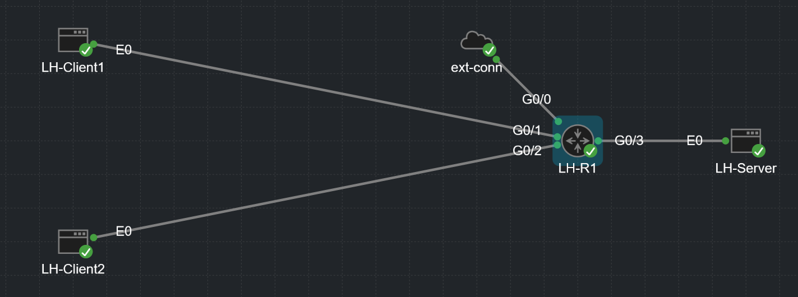

# Sprint 4 Network Verification Report

**Course:** CS 457
**Written by:** Landon Holland
**Server hostname:** `server.holland.edu` -> `192.168.20.100`

This report verifies the one-router CML topology the Battleship game runs on (SOW #5). One Cisco IOSv router, `LH-R1`, connects the two client subnets and the server subnet, hands out client addresses with DHCP, and answers DNS for `server.holland.edu`.

| Deliverable | File |
| ----------- | ---- |
| CML topology export | [sprint_4_topology.yaml](sprint_4_topology.yaml) |
| DNS packet capture | [sprint_4_dns_lookup.pcap](sprint_4_dns_lookup.pcap) |
| This report | `sprint_4_network_report.md` |

---

## 1. Topology

The CML topology, with every node named with my initials and every link labeled with its interfaces:



| Node | Type | Interface | Address | Gateway | DNS server | How it gets its address |
| ---- | ---- | --------- | ------- | ------- | ---------- | ----------------------- |
| `LH-R1` | Cisco IOSv | `Gi0/1` (Subnet A) | `192.168.10.1/24` | | | Static |
| `LH-R1` | | `Gi0/2` (Subnet B) | `192.168.11.1/24` | | | Static |
| `LH-R1` | | `Gi0/3` (Subnet C) | `192.168.20.1/24` | | | Static |
| `LH-R1` | | `Gi0/0` (External Connector) | `192.168.255.x` | | | DHCP from the External Connector |
| `LH-Client1` | Alpine Linux | `eth0` | `192.168.10.2/24` | `192.168.10.1` | `192.168.10.1` | DHCP, `CLIENT1_POOL` |
| `LH-Client2` | Alpine Linux | `eth0` | `192.168.11.2/24` | `192.168.11.1` | `192.168.11.1` | DHCP, `CLIENT2_POOL` |
| `LH-Server` | Alpine Linux | `eth0` | `192.168.20.100/24` | `192.168.20.1` | `192.168.20.1` | Static |

All three subnets are directly connected to `LH-R1`, so it routes between them with connected (`C`) routes and needs no static routes. `Gi0/0` and NAT overload exist only so the nodes can install packages and clone the repository. The game traffic never leaves the three subnets.

---

## 2. Router `LH-R1` Configuration

This is the configuration on `LH-R1`, grouped by purpose (it was entered in chunks).

```text
enable
configure terminal
hostname LH-R1
ip routing

! Gateways for the three subnets
interface GigabitEthernet0/1
 ip address 192.168.10.1 255.255.255.0
 ip nat inside
 no shutdown
 exit
interface GigabitEthernet0/2
 ip address 192.168.11.1 255.255.255.0
 ip nat inside
 no shutdown
 exit
interface GigabitEthernet0/3
 ip address 192.168.20.1 255.255.255.0
 ip nat inside
 no shutdown
 exit

! Link to the CML External Connector (NAT mode)
interface GigabitEthernet0/0
 ip address dhcp
 ip nat outside
 no shutdown
 exit

! DHCP: never lease the gateway addresses
ip dhcp excluded-address 192.168.10.1
ip dhcp excluded-address 192.168.11.1
ip dhcp pool CLIENT1_POOL
 network 192.168.10.0 255.255.255.0
 default-router 192.168.10.1
 dns-server 192.168.10.1
 exit
ip dhcp pool CLIENT2_POOL
 network 192.168.11.0 255.255.255.0
 default-router 192.168.11.1
 dns-server 192.168.11.1
 exit

! Authoritative DNS for the game server
ip domain lookup
ip dns server
ip host server.holland.edu 192.168.20.100

! NAT overload (PAT) for all three subnets out Gi0/0
access-list 1 permit 192.168.10.0 0.0.0.255
access-list 1 permit 192.168.11.0 0.0.0.255
access-list 1 permit 192.168.20.0 0.0.0.255
ip nat inside source list 1 interface GigabitEthernet0/0 overload

end
write memory
```

The DHCP, DNS, and NAT lines were checked on the router with `show running-config | section dhcp` and `show running-config | include ip host|ip dns|ip domain|ip nat|access-list` ([console screenshot](screenshots/r1_dhcp_dns_nat_config.png)). `ip domain lookup` is the IOS default, so the running config does not list it.

---

## 3. Router Verification

### 3.1 `show ip interface brief`

`Gi0/1`, `Gi0/2`, and `Gi0/3` have their gateway addresses and are all `up` / `up`. `Gi0/0` took `192.168.255.217` from the External Connector by DHCP.

```text
LH-R1#show ip interface brief
Interface                  IP-Address      OK? Method Status                Protocol
GigabitEthernet0/0         192.168.255.217 YES DHCP   up                    up
GigabitEthernet0/1         192.168.10.1    YES manual up                    up
GigabitEthernet0/2         192.168.11.1    YES manual up                    up
GigabitEthernet0/3         192.168.20.1    YES manual up                    up
NVI0                       192.168.10.1    YES unset  up                    up
```

`NVI0` is the NAT Virtual Interface. IOS creates it by itself once `ip nat inside` and `ip nat outside` are configured, and it borrows the address of an inside interface. It was not configured by hand and plays no part in routing between the three subnets. [Console screenshot](screenshots/r1_show_ip_interface_brief.png).

### 3.2 `show ip route`

Shows `192.168.10.0/24`, `192.168.11.0/24`, and `192.168.20.0/24` as connected (`C`) routes, so `LH-R1` routes between the three subnets without any static route.

```text
TO FILL: paste the output of "show ip route" on LH-R1
```

### 3.3 `show ip dhcp binding`

Shows an active lease for each client, on its own subnet: `192.168.10.2` for `LH-Client1` and `192.168.11.2` for `LH-Client2`.

```text
TO FILL: paste the output of "show ip dhcp binding" on LH-R1
```

### 3.4 `show hosts`

Shows the static A record `server.holland.edu` -> `192.168.20.100`.

```text
TO FILL: paste the output of "show hosts" on LH-R1
```

---

## 4. Game Server `LH-Server` (Static Address)

Commands entered on `LH-Server`:

```text
sudo ip addr add 192.168.20.100/24 dev eth0
sudo ip link set eth0 up
sudo ip route add default via 192.168.20.1
echo "nameserver 192.168.20.1" | sudo tee /etc/resolv.conf
```

The default route matters: without it the server could receive a packet from `192.168.10.x` or `192.168.11.x` but could not send the reply.

`ip addr show eth0` and `ip route` show `192.168.20.100/24` and `default via 192.168.20.1`:

```text
LH-Server:~$ ip addr show eth0
2: eth0: <BROADCAST,MULTICAST,UP,LOWER_UP> mtu 1500 qdisc pfifo_fast state UP qlen 1000
    link/ether 52:54:00:71:b9:35 brd ff:ff:ff:ff:ff:ff
    inet 192.168.20.100/24 scope global eth0
       valid_lft forever preferred_lft forever
    inet6 fe80::5054:ff:fe71:b935/64 scope link
       valid_lft forever preferred_lft forever
```

```text
LH-Server:~$ ip route
default via 192.168.20.1 dev eth0
192.168.20.0/24 dev eth0 scope link  src 192.168.20.100
```

Console screenshots: [ip addr](screenshots/server_ip_addr.png), [ip route](screenshots/server_ip_route.png).

---

## 5. Clients `LH-Client1` and `LH-Client2` (DHCP, Ping, DNS)

Each client brought up `eth0` and asked `LH-R1` for a lease:

```text
sudo ip link set eth0 up
sudo udhcpc -i eth0
```

### 5.1 `LH-Client1` (Subnet A)

The lease, default route, and DNS server from `CLIENT1_POOL` (`ip addr show eth0`, `ip route`, `cat /etc/resolv.conf`):

```text
LH-Client1:~$ sudo ip link set eth0 up
LH-Client1:~$ sudo udhcpc -i eth0
udhcpc: started, v1.37.0
udhcpc: broadcasting discover
udhcpc: broadcasting select for 192.168.10.2, server 192.168.10.1
udhcpc: lease of 192.168.10.2 obtained from 192.168.10.1, lease time 86400
LH-Client1:~$ ip addr show eth0
2: eth0: <BROADCAST,MULTICAST,UP,LOWER_UP> mtu 1500 qdisc pfifo_fast state UP qlen 1000
    link/ether 52:54:00:0b:2d:72 brd ff:ff:ff:ff:ff:ff
    inet 192.168.10.2/24 scope global eth0
       valid_lft forever preferred_lft forever
    inet6 fe80::5054:ff:fe0b:2d72/64 scope link
       valid_lft forever preferred_lft forever
LH-Client1:~$ ip route
default via 192.168.10.1 dev eth0  metric 202
192.168.10.0/24 dev eth0 scope link  src 192.168.10.2
LH-Client1:~$ cat /etc/resolv.conf
nameserver 192.168.10.1
```

`udhcpc` shows the DHCP exchange: a broadcast Discover, a Request ("select") for the offered `192.168.10.2`, and the lease from `LH-R1` (`192.168.10.1`). The lease installed the default route (option 3, `default-router`) and the DNS server (option 6, `dns-server`), both `192.168.10.1`. [Console screenshot](screenshots/client1_dhcp.png).

Zero-loss ping to the game server across `LH-R1` (`ping -c 4 192.168.20.100`):

```text
LH-Client1:~$ ping -c 4 192.168.20.100
PING 192.168.20.100 (192.168.20.100): 56 data bytes
64 bytes from 192.168.20.100: seq=0 ttl=42 time=13.722 ms
64 bytes from 192.168.20.100: seq=1 ttl=42 time=2.925 ms
64 bytes from 192.168.20.100: seq=2 ttl=42 time=3.968 ms
64 bytes from 192.168.20.100: seq=3 ttl=42 time=3.207 ms

--- 192.168.20.100 ping statistics ---
4 packets transmitted, 4 packets received, 0% packet loss
round-trip min/avg/max = 2.925/5.955/13.722 ms
```

Name resolution through `LH-R1` (`nslookup -type=A server.holland.edu`):

```text
LH-Client1:~$ nslookup -type=A server.holland.edu
Server:         192.168.10.1
Address:        192.168.10.1:53

Non-authoritative answer:
Name:   server.holland.edu
Address: 192.168.20.100
```

The query went to `192.168.10.1` on UDP port 53 (`LH-R1`, the DNS server from the DHCP lease) and came back with `192.168.20.100`. [Console screenshot](screenshots/client1_ping_nslookup.png).

### 5.2 `LH-Client2` (Subnet B)

```text
LH-Client2:~$ sudo ip link set eth0 up
LH-Client2:~$ sudo udhcpc -i eth0
udhcpc: started, v1.37.0
udhcpc: broadcasting discover
udhcpc: broadcasting select for 192.168.11.2, server 192.168.11.1
udhcpc: lease of 192.168.11.2 obtained from 192.168.11.1, lease time 86400
LH-Client2:~$ ip addr show eth0
2: eth0: <BROADCAST,MULTICAST,UP,LOWER_UP> mtu 1500 qdisc pfifo_fast state UP qlen 1000
    link/ether 52:54:00:65:c7:13 brd ff:ff:ff:ff:ff:ff
    inet 192.168.11.2/24 scope global eth0
       valid_lft forever preferred_lft forever
    inet6 fe80::5054:ff:fe65:c713/64 scope link
       valid_lft forever preferred_lft forever
LH-Client2:~$ ip route
default via 192.168.11.1 dev eth0  metric 202
192.168.11.0/24 dev eth0 scope link  src 192.168.11.2
LH-Client2:~$ cat /etc/resolv.conf
nameserver 192.168.11.1
```

`CLIENT2_POOL` leased `192.168.11.2`, with default route and DNS server `192.168.11.1`, on Client 2's own subnet. [Console screenshot](screenshots/client2_dhcp.png).

```text
TO FILL: paste "ping -c 4 192.168.20.100" from LH-Client2
```

```text
TO FILL: paste "nslookup -type=A server.holland.edu" from LH-Client2 (should answer 192.168.20.100 from server 192.168.11.1)
```

`-type=A` is used because Alpine's `nslookup` also asks for an AAAA (IPv6) record by default, and `LH-R1` only has the IPv4 A record. The game client asks for the A record only: `socket.gethostbyname()` is IPv4-only (`client.py`, `resolve`).

---

## 6. Wireshark DNS Capture

The capture `sprint_4_dns_lookup.pcap` was taken on the `LH-Client1` to `LH-R1` link while `LH-Client1` ran `nslookup -type=A server.holland.edu`. Display filter: `dns`.

TO FILL: annotated Wireshark screenshot of the query and the response, with the response's answer section expanded.


The annotations are here rather than inside the capture file: a `.pcap` cannot store Wireshark packet comments (only `.pcapng` can), and the deliverable must be a `.pcap`.

| Packet | Source | Destination | Protocol | What it shows |
| ------ | ------ | ----------- | -------- | ------------- |
| TO FILL (number) | TO FILL (expected `192.168.10.2`) | TO FILL (expected `192.168.10.1`) | DNS (UDP, destination port 53) | **Standard query:** `LH-Client1` asks its DHCP-assigned DNS server, `LH-R1`, for the A record of `server.holland.edu`. The source port is a random high port. |
| TO FILL (number) | TO FILL (expected `192.168.10.1`) | TO FILL (expected `192.168.10.2`) | DNS (UDP, source port 53) | **Standard query response:** `LH-R1` answers from its own host table (`ip host`) with one A record, `server.holland.edu` -> `192.168.20.100`. The transaction ID matches the query's, and the destination port is the query's source port. |

TO FILL: the transaction ID seen in both packets: `0x____`.

---

## 7. Rubric Checklist

| Rubric item | Evidence |
| ----------- | -------- |
| 1. One router, three subnets, server static IP and default route, interfaces up/up | #1 table and screenshot, #2 configuration, #3.1, #3.2, #4 |
| 2. Separate DHCP pools with excluded gateways, default router, and DNS server; leases for both clients | #2 configuration, #3.3, #5.1 and #5.2 lease output |
| 3. `ip dns server` and `ip host server.holland.edu 192.168.20.100`; both clients resolve it | #2 configuration, #3.4, both `nslookup` outputs in #5 |
| 4. Zero-loss ping from both clients; DNS capture with query and response | Both `ping` outputs in #5, #6, `sprint_4_dns_lookup.pcap` |
| 5. YAML export with initialed node names; this report | `sprint_4_topology.yaml`, #1 screenshot, this report |
