# Sprint 4 Network Verification Report

**Course:** CS 457
**Written by:** Landon Holland
**Server hostname:** `server.holland.edu` -> `192.168.20.100`

This report shows the CML topology the Battleship game runs on. 1 Cisco IOSv router, `LH-R1` connects the two client subnets and the server subnet, the router also hands out client addresses with DHCP, and answers DNS for `server.holland.edu`.

| Deliverable | File |
| ----------- | ---- |
| CML topology export | [sprint_4_topology.yaml](sprint_4_topology.yaml) |
| DNS packet capture | [sprint_4_dns_lookup.pcap](sprint_4_dns_lookup.pcap) |
| This report | `sprint_4_network_report.md` |

---

## 1. Topology

The CML topology, with every node named with my initials and every link labeled with its interfaces:


| Node | Type | Interface | Address | Gateway | DNS server | How it gets its address |
| ---- | ---- | --------- | ------- | ------- | ---------- | ----------------------- |
| `LH-R1` | Cisco IOSv | `Gi0/1` (Subnet A) | `192.168.10.1/24` | | | Static |
| `LH-R1` | | `Gi0/2` (Subnet B) | `192.168.11.1/24` | | | Static |
| `LH-R1` | | `Gi0/3` (Subnet C) | `192.168.20.1/24` | | | Static |
| `LH-R1` | | `Gi0/0` (External Connector) | `192.168.255.x` | | | DHCP from the External Connector |
| `LH-Client1` | Alpine Linux | `eth0` | `192.168.10.2/24` | `192.168.10.1` | `192.168.10.1` | DHCP, `CLIENT1_POOL` |
| `LH-Client2` | Alpine Linux | `eth0` | `192.168.11.2/24` | `192.168.11.1` | `192.168.11.1` | DHCP, `CLIENT2_POOL` |
| `LH-Server` | Alpine Linux | `eth0` | `192.168.20.100/24` | `192.168.20.1` | `192.168.20.1` | Static |

**Note on the YAML export:** the node labels in `sprint_4_topology.yaml` are the different names (`LH-R1`, `LH-Client1`, `LH-Client2`, `LH-Server`), and it holds `LH-R1`'s full saved configuration. Two text fields still carry the names the nodes had when they were made initially for some reason: the link labels (the `Gi0/3` link reads `LH-R1-GigabitEthernet0/3<->LH-CLIENT3-eth0`) and the Alpine nodes' saved `hostname` lines (`lh-c1`, `lh-c2`, `lh-c3`).

All subnets are directly connected to `LH-R1`, so it routes between them with connected (`C`) routes and needs no static routes. `Gi0/0` and NAT overload exist only so the nodes can install packages and clone the repository. The game traffic never leaves the three subnets.

---

## 2. Router `LH-R1` Configuration

This is the configuration on `LH-R1`:

```text
enable
configure terminal
hostname LH-R1
ip routing

! Gateways for the three subnets
interface GigabitEthernet0/1
 ip address 192.168.10.1 255.255.255.0
 ip nat inside
 no shutdown
 exit
interface GigabitEthernet0/2
 ip address 192.168.11.1 255.255.255.0
 ip nat inside
 no shutdown
 exit
interface GigabitEthernet0/3
 ip address 192.168.20.1 255.255.255.0
 ip nat inside
 no shutdown
 exit

! Link to the CML External Connector (NAT mode)
interface GigabitEthernet0/0
 ip address dhcp
 ip nat outside
 no shutdown
 exit

! DHCP: never lease the gateway addresses
ip dhcp excluded-address 192.168.10.1
ip dhcp excluded-address 192.168.11.1
ip dhcp pool CLIENT1_POOL
 network 192.168.10.0 255.255.255.0
 default-router 192.168.10.1
 dns-server 192.168.10.1
 exit
ip dhcp pool CLIENT2_POOL
 network 192.168.11.0 255.255.255.0
 default-router 192.168.11.1
 dns-server 192.168.11.1
 exit

! Authoritative DNS for the game server
ip domain lookup
ip dns server
ip host server.holland.edu 192.168.20.100

! NAT overload (PAT) for all three subnets out Gi0/0
access-list 1 permit 192.168.10.0 0.0.0.255
access-list 1 permit 192.168.11.0 0.0.0.255
access-list 1 permit 192.168.20.0 0.0.0.255
ip nat inside source list 1 interface GigabitEthernet0/0 overload

end
write memory
```

The DHCP, DNS, and NAT lines were checked on the router by using commands: `show running-config | section dhcp` and `show running-config | include ip host|ip dns|ip domain|ip nat|access-list`.

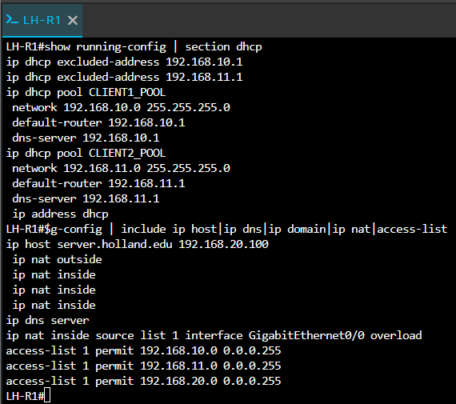

---

## 3. Router Verification

### 3.1 `show ip interface brief`

`Gi0/1`, `Gi0/2`, and `Gi0/3` have their gateway addresses and are all `up` / `up`. `Gi0/0` took `192.168.255.217` from the `ext-conn` by DHCP.

```text
LH-R1#show ip interface brief
Interface                  IP-Address      OK? Method Status                Protocol
GigabitEthernet0/0         192.168.255.217 YES DHCP   up                    up
GigabitEthernet0/1         192.168.10.1    YES manual up                    up
GigabitEthernet0/2         192.168.11.1    YES manual up                    up
GigabitEthernet0/3         192.168.20.1    YES manual up                    up
NVI0                       192.168.10.1    YES unset  up                    up
```

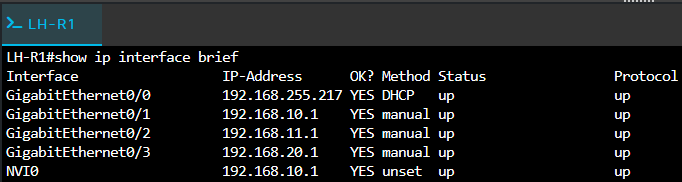

### 3.2 `show ip route`

Shows `192.168.10.0/24`, `192.168.11.0/24`, and `192.168.20.0/24` as connected (`C`) routes, so `LH-R1` routes between the three subnets without any static route.

```text
LH-R1#show ip route
Codes: L - local, C - connected, S - static, R - RIP, M - mobile, B - BGP
       D - EIGRP, EX - EIGRP external, O - OSPF, IA - OSPF inter area
       N1 - OSPF NSSA external type 1, N2 - OSPF NSSA external type 2
       E1 - OSPF external type 1, E2 - OSPF external type 2
       i - IS-IS, su - IS-IS summary, L1 - IS-IS level-1, L2 - IS-IS level-2
       ia - IS-IS inter area, * - candidate default, U - per-user static route
       o - ODR, P - periodic downloaded static route, H - NHRP, l - LISP
       a - application route
       + - replicated route, % - next hop override, p - overrides from PfR

Gateway of last resort is 192.168.255.1 to network 0.0.0.0

S*    0.0.0.0/0 [254/0] via 192.168.255.1
      192.168.10.0/24 is variably subnetted, 2 subnets, 2 masks
C        192.168.10.0/24 is directly connected, GigabitEthernet0/1
L        192.168.10.1/32 is directly connected, GigabitEthernet0/1
      192.168.11.0/24 is variably subnetted, 2 subnets, 2 masks
C        192.168.11.0/24 is directly connected, GigabitEthernet0/2
L        192.168.11.1/32 is directly connected, GigabitEthernet0/2
      192.168.20.0/24 is variably subnetted, 2 subnets, 2 masks
C        192.168.20.0/24 is directly connected, GigabitEthernet0/3
L        192.168.20.1/32 is directly connected, GigabitEthernet0/3
      192.168.255.0/24 is variably subnetted, 2 subnets, 2 masks
C        192.168.255.0/24 is directly connected, GigabitEthernet0/0
L        192.168.255.217/32 is directly connected, GigabitEthernet0/0
```

The three game subnets are connected (`C`) routes, with `L` entries for the router's own address on each. The `S*` default route was not configured by hand: `ip address dhcp` on `Gi0/0` installs it from the External Connector's lease, with administrative distance 254. It only carries traffic leaving the lab (package installs); traffic between the three subnets uses the connected routes.

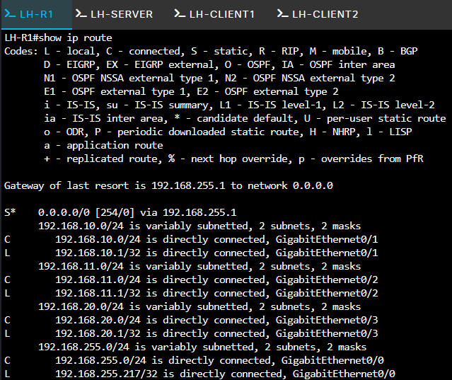

### 3.3 `show ip dhcp binding`

Shows an active lease for each client, on its own subnet: `192.168.10.2` for `LH-Client1` and `192.168.11.2` for `LH-Client2`.

```text
LH-R1#show ip dhcp binding
Bindings from all pools not associated with VRF:
IP address          Client-ID/              Lease expiration        Type
                    Hardware address/
                    User name
192.168.10.2        0152.5400.0b2d.72       Nov 21 2026 08:40 AM    Automatic
192.168.11.2        0152.5400.65c7.13       Nov 21 2026 08:43 AM    Automatic
```

One active lease per client.  Each client is on its own subnet. The Client-ID is `01` (Ethernet) followed by the client's MAC address: `52:54:00:0b:2d:72` is `LH-Client1` and `52:54:00:65:c7:13` is `LH-Client2`.

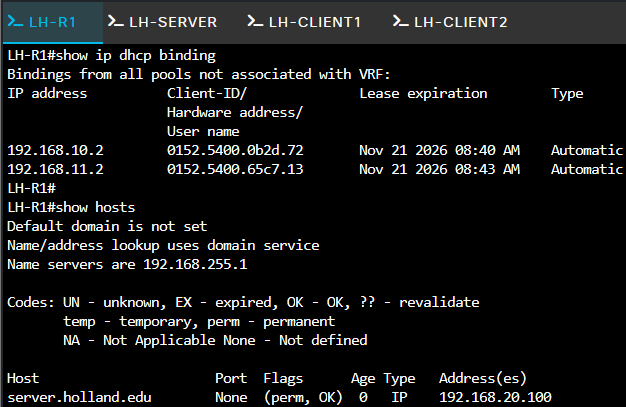

### 3.4 `show hosts`

Shows the static A record `server.holland.edu` -> `192.168.20.100`.

```text
LH-R1#show hosts
Default domain is not set
Name/address lookup uses domain service
Name servers are 192.168.255.1

Codes: UN - unknown, EX - expired, OK - OK, ?? - revalidate
       temp - temporary, perm - permanent
       NA - Not Applicable None - Not defined

Host                      Port  Flags      Age Type   Address(es)
server.holland.edu        None  (perm, OK)  0   IP    192.168.20.100
```

`server.holland.edu` is a `perm` entry from `ip host`. This is so that `LH-R1` answers it from its own table. `192.168.255.1` is the upstream name server learned on `Gi0/0`, used only for names `LH-R1` does not have itself.

---

## 4. Game Server `LH-Server` (Static Address)

Commands entered on `LH-Server`:

```text
sudo ip addr add 192.168.20.100/24 dev eth0
sudo ip link set eth0 up
sudo ip route add default via 192.168.20.1
echo "nameserver 192.168.20.1" | sudo tee /etc/resolv.conf
```

The default route matters because without it the server could receive a packet from `192.168.10.x` or `192.168.11.x` but could not send the reply.

`ip addr show eth0` and `ip route` show `192.168.20.100/24` and `default via 192.168.20.1`:

```text
LH-Server:~$ ip addr show eth0
2: eth0: <BROADCAST,MULTICAST,UP,LOWER_UP> mtu 1500 qdisc pfifo_fast state UP qlen 1000
    link/ether 52:54:00:71:b9:35 brd ff:ff:ff:ff:ff:ff
    inet 192.168.20.100/24 scope global eth0
       valid_lft forever preferred_lft forever
    inet6 fe80::5054:ff:fe71:b935/64 scope link
       valid_lft forever preferred_lft forever
```

```text
LH-Server:~$ ip route
default via 192.168.20.1 dev eth0
192.168.20.0/24 dev eth0 scope link  src 192.168.20.100
```

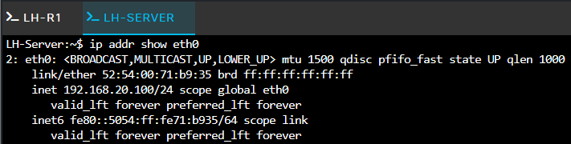

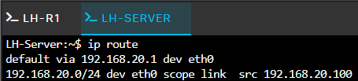

---

## 5. Clients `LH-Client1` and `LH-Client2` (DHCP, Ping, DNS)

Each client brought up `eth0` and asked `LH-R1` for a lease:

```text
sudo ip link set eth0 up
sudo udhcpc -i eth0
```

### 5.1 `LH-Client1` (Subnet A)

The lease, default route, and DNS server from `CLIENT1_POOL` (`ip addr show eth0`, `ip route`, `cat /etc/resolv.conf`):

```text
LH-Client1:~$ sudo ip link set eth0 up
LH-Client1:~$ sudo udhcpc -i eth0
udhcpc: started, v1.37.0
udhcpc: broadcasting discover
udhcpc: broadcasting select for 192.168.10.2, server 192.168.10.1
udhcpc: lease of 192.168.10.2 obtained from 192.168.10.1, lease time 86400
LH-Client1:~$ ip addr show eth0
2: eth0: <BROADCAST,MULTICAST,UP,LOWER_UP> mtu 1500 qdisc pfifo_fast state UP qlen 1000
    link/ether 52:54:00:0b:2d:72 brd ff:ff:ff:ff:ff:ff
    inet 192.168.10.2/24 scope global eth0
       valid_lft forever preferred_lft forever
    inet6 fe80::5054:ff:fe0b:2d72/64 scope link
       valid_lft forever preferred_lft forever
LH-Client1:~$ ip route
default via 192.168.10.1 dev eth0  metric 202
192.168.10.0/24 dev eth0 scope link  src 192.168.10.2
LH-Client1:~$ cat /etc/resolv.conf
nameserver 192.168.10.1
```

`udhcpc` shows the DHCP exchange. First, a broadcast Discover, then a Request ("select") for the offered `192.168.10.2`, and then the lease from `LH-R1` (`192.168.10.1`). The lease installed the default route and the DNS server. Both are `192.168.10.1`.

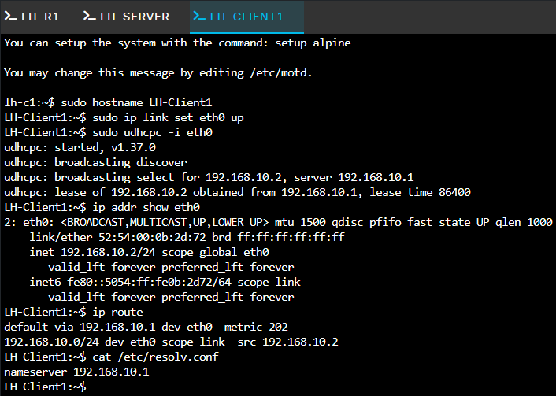

Zero loss ping to the game server across `LH-R1` (`ping -c 4 192.168.20.100`):

```text
LH-Client1:~$ ping -c 4 192.168.20.100
PING 192.168.20.100 (192.168.20.100): 56 data bytes
64 bytes from 192.168.20.100: seq=0 ttl=42 time=13.722 ms
64 bytes from 192.168.20.100: seq=1 ttl=42 time=2.925 ms
64 bytes from 192.168.20.100: seq=2 ttl=42 time=3.968 ms
64 bytes from 192.168.20.100: seq=3 ttl=42 time=3.207 ms

--- 192.168.20.100 ping statistics ---
4 packets transmitted, 4 packets received, 0% packet loss
round-trip min/avg/max = 2.925/5.955/13.722 ms
```

Name resolution through `LH-R1` (`nslookup -type=A server.holland.edu`):

```text
LH-Client1:~$ nslookup -type=A server.holland.edu
Server:         192.168.10.1
Address:        192.168.10.1:53

Non-authoritative answer:
Name:   server.holland.edu
Address: 192.168.20.100
```

The query went to `192.168.10.1` on UDP port 53, which is `LH-R1`: the DNS server from the DHCP lease. It came back with `192.168.20.100`.

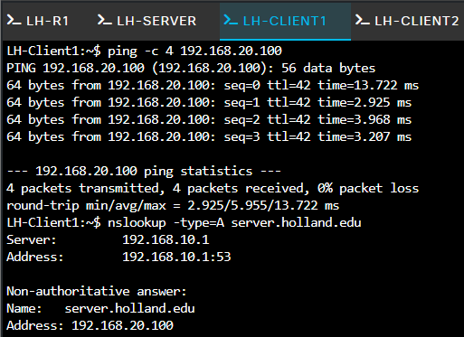

### 5.2 `LH-Client2` (Subnet B)

```text
LH-Client2:~$ sudo ip link set eth0 up
LH-Client2:~$ sudo udhcpc -i eth0
udhcpc: started, v1.37.0
udhcpc: broadcasting discover
udhcpc: broadcasting select for 192.168.11.2, server 192.168.11.1
udhcpc: lease of 192.168.11.2 obtained from 192.168.11.1, lease time 86400
LH-Client2:~$ ip addr show eth0
2: eth0: <BROADCAST,MULTICAST,UP,LOWER_UP> mtu 1500 qdisc pfifo_fast state UP qlen 1000
    link/ether 52:54:00:65:c7:13 brd ff:ff:ff:ff:ff:ff
    inet 192.168.11.2/24 scope global eth0
       valid_lft forever preferred_lft forever
    inet6 fe80::5054:ff:fe65:c713/64 scope link
       valid_lft forever preferred_lft forever
LH-Client2:~$ ip route
default via 192.168.11.1 dev eth0  metric 202
192.168.11.0/24 dev eth0 scope link  src 192.168.11.2
LH-Client2:~$ cat /etc/resolv.conf
nameserver 192.168.11.1
```

`CLIENT2_POOL` leased `192.168.11.2`, with default route and DNS server `192.168.11.1`, on Client 2's own subnet.

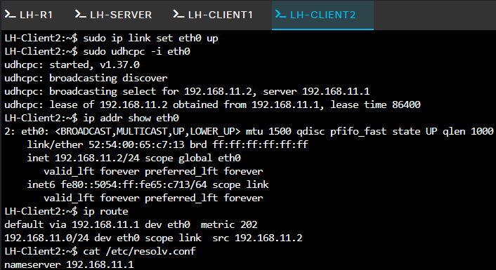

```text
LH-Client2:~$ ping -c 4 192.168.20.100
PING 192.168.20.100 (192.168.20.100): 56 data bytes
64 bytes from 192.168.20.100: seq=0 ttl=42 time=5.724 ms
64 bytes from 192.168.20.100: seq=1 ttl=42 time=3.101 ms
64 bytes from 192.168.20.100: seq=2 ttl=42 time=3.201 ms
64 bytes from 192.168.20.100: seq=3 ttl=42 time=2.850 ms

--- 192.168.20.100 ping statistics ---
4 packets transmitted, 4 packets received, 0% packet loss
round-trip min/avg/max = 2.850/3.719/5.724 ms
```

```text
LH-Client2:~$ nslookup -type=A server.holland.edu
Server:         192.168.11.1
Address:        192.168.11.1:53

Non-authoritative answer:
Name:   server.holland.edu
Address: 192.168.20.100
```

Client 2 asks its own gateway, `192.168.11.1`, which is the same router, and gets the same answer.

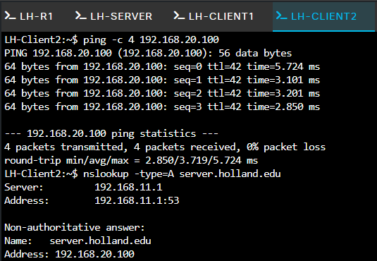

`-type=A` is used because Alpine's `nslookup` also asks for an AAAA (IPv6) record by default, and `LH-R1` only has the IPv4 A record. The game client asks for the A record only: `socket.gethostbyname()` is IPv4-only (`client.py`, `resolve`).

---

## 6. Wireshark DNS Capture

The capture `sprint_4_dns_lookup.pcap` was taken on the `LH-Client1` to `LH-R1` link while `LH-Client1` ran `nslookup -type=A server.holland.edu`. It holds three packets: the DNS query, the DNS response, and one Ethernet keepalive (no display filter is applied below).

The annotated capture. Packet 1 is the query to UDP port 53. Packet 2 is selected, with its Answers section expanded to the A record `192.168.20.100`:

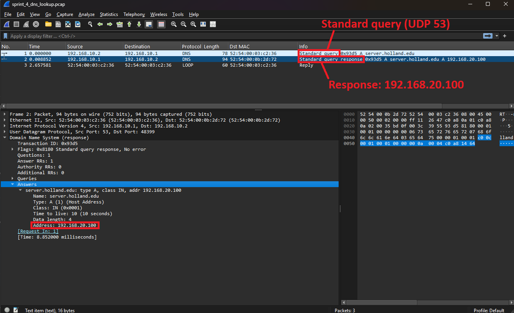

| Packet | Time | Source | Destination | Protocol | What it shows |
| ------ | ---- | ------ | ----------- | -------- | ------------- |
| 1 | 0.000000 s | `192.168.10.2`, UDP port 48399 | `192.168.10.1`, UDP port **53** | DNS | **Standard query `0x93d5`:** `LH-Client1` asks its DHCP assigned DNS server, `LH-R1`, for the A record of `server.holland.edu` (type A, class IN). The source port is a random high port. |
| 2 | 0.008852 s | `192.168.10.1`, UDP port **53** | `192.168.10.2`, UDP port 48399 | DNS | **Standard query response `0x93d5`:** `LH-R1` answers with one A record, `server.holland.edu` -> **`192.168.20.100`** Same transaction ID as the query, sent back to the query's source port. |
| 3 | 2.657581 s | `52:54:00:03:c2:36` | `52:54:00:03:c2:36` | LOOP | Not part of the DNS exchange. |

**Response flags `0x8180`:** Response, standard query, recursion desired, recursion available, no error. The Authoritative Answer bit is `0`, which is why `nslookup` prints "Non-authoritative answer" in #5.